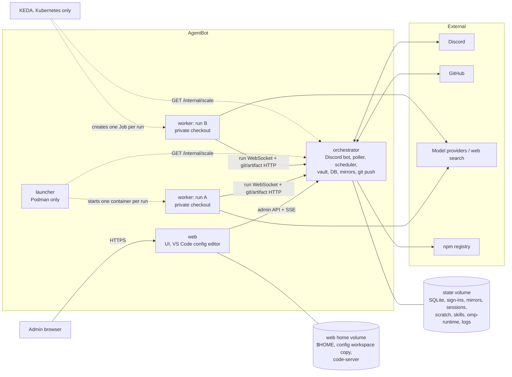
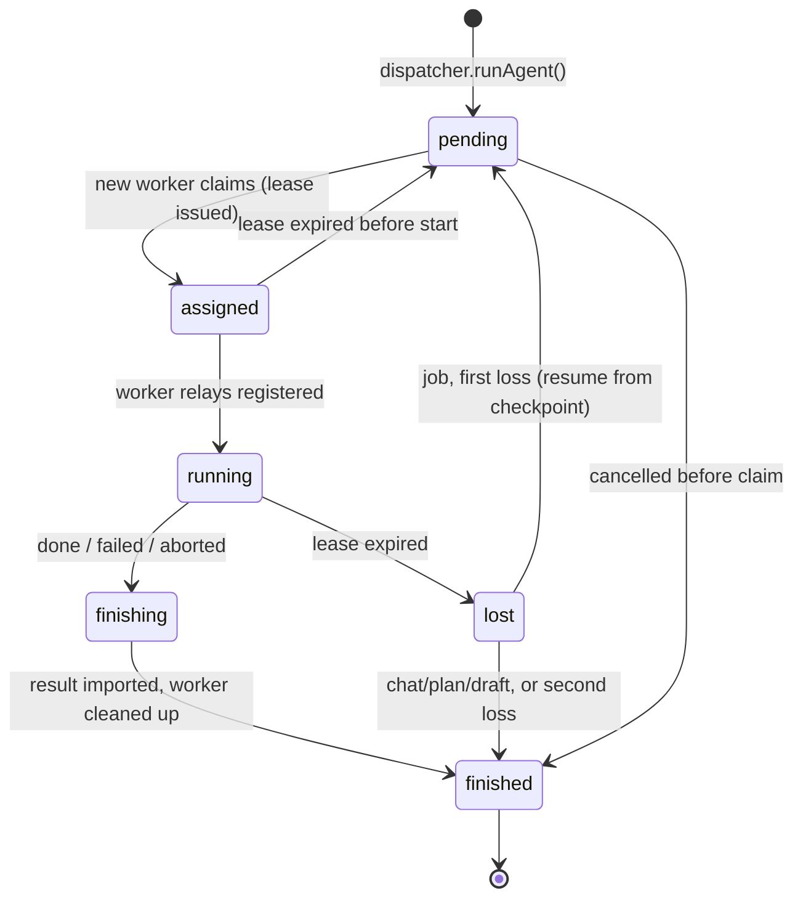
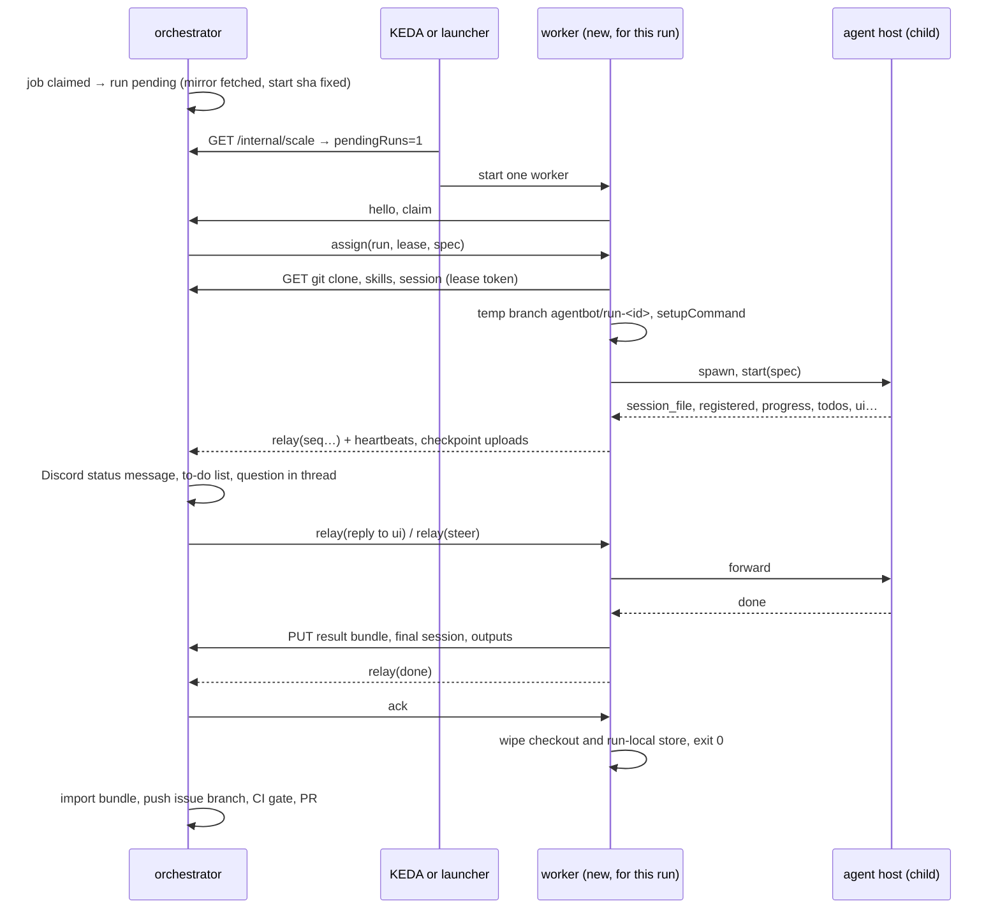
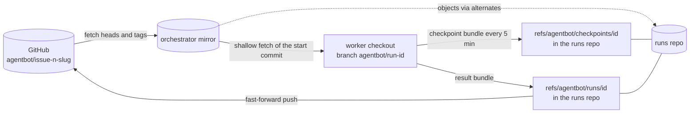

# Architecture

This document describes how AgentBot is built and deployed. It builds on [requirements.md](requirements.md); where the design here changes a requirement, §10 lists the change and requirements.md has been updated.

DevForge runs everything in one container: web UI, Discord bot, GitHub poller, scheduler and one child process per agent run. AgentBot splits that apart:
- the bot keeps running while the web UI restarts;
- **every agent run gets its own short-lived worker** with a private checkout on a temporary branch;
- the worker is deleted when the run ends.

## 1. Decisions

| # | Decision | Alternative rejected | Why |
|---|---|---|---|
| A-1 | Separate components: **web**, **orchestrator** (the chatbot), **worker** (one per agent run) and, on Podman, a **launcher** that starts the workers. | Keep one process. | The bot must be independent of the website and the omp processes, and each run must be isolated. |
| A-2 | The orchestrator is a **singleton** and the only owner of the database, the vault, the git mirrors and all GitHub and Discord credentials. | Several replicas with leader election. | Discord allows one gateway session per bot, the poller must run once, and SQLite has one writer. Leader election would add a lot of moving parts for no throughput gain. |
| A-3 | **One worker per agent run, with a private checkout.** The worker makes a shallow checkout of the run's start commit from the orchestrator (read-only, no GitHub credentials), works on a temporary branch, and returns its commits as a git bundle. The orchestrator pushes. Workers share no volume. *(Replaces the earlier shared workspace volume.)* | A shared ReadWriteMany volume with one worktree per run. | Runs cannot see each other's code, sessions or files. No RWX storage is needed. Cost: a checkout and `setupCommand` at the start of every run. |
| A-4 | Kubernetes starts workers with a **KEDA ScaledJob**, 0–10: one Job pod per agent run. | Orchestrator creates Jobs itself; a Deployment with a KEDA ScaledObject. | A Job finishes when its run finishes, so scale-down never kills a busy pod. The orchestrator needs no Kubernetes API permissions. Cost: KEDA must be installed. |
| A-5 | Workers **pull** their run from the orchestrator over a WebSocket. | The orchestrator pushes to worker endpoints. | Workers need no Service or published port, and the same worker code runs under the launcher and under KEDA. |
| A-6 | omp updates stay **in place, for workers only**. After Discord approval the orchestrator installs and packs a newer omp. Each new worker downloads it, falling back to the image's omp if it fails. | Image-only updates. | Users can take a new omp without rebuilding or redeploying. Running runs are not interrupted, and no component restarts. |
| A-7 | **One image** with four roles (`agentbot orchestrator`, `agentbot web`, `agentbot worker`, `agentbot launcher`). The worker image can be overridden with a derived image that adds target-repo toolchains. | Separate images. | One build, one version and shared layers. Toolchains still go only where they are needed. |
| A-8 | **SQLite stays**, for both AgentBot's database and omp's model sign-in store, on a volume that only the orchestrator mounts (RWO). | Postgres; a separate credentials database. | There is a single writer (A-2), and omp already uses SQLite for sign-ins, so no new database is needed. |
| A-9 | **Model sign-ins stay in the orchestrator** (§6.1). Runs get a copy in the run spec, and token refreshes go through the orchestrator. | A shared sign-in store. | Keeps one refresh-token chain per provider. |
| A-10 | On Docker/Podman hosts, a **launcher** starts one worker container per run through a **rootless Podman** API socket. | A rootful Docker socket; long-lived pool workers. | Per-run containers need something that can start containers. A rootless socket limits that power to one unprivileged host user. Cost: per-run workers need Podman, not Docker Engine. |
| A-11 | **VS Code is a configuration editor.** It opens a workspace holding the settings, the omp settings and MCP servers, and the skills and agents, synced with the orchestrator, which validates and applies every save (§2.5). There is no browser terminal, no SSH, and VS Code's built-in terminal is disabled. | VS Code as a workbench over repo clones; the tmux browser terminal; SSH for desktop VS Code. | Workers' checkouts are private (A-3), so there is nothing useful left to browse. Editing configuration as files is easier than forms for skills, agents and large settings. |

## 2. Components



| | web | orchestrator | worker | launcher (Podman) |
|---|---|---|---|---|
| Role | UI and configuration editor | The chatbot and the system's brain | Runs exactly one omp session, then exits | Starts and removes worker containers |
| Replicas | 1 (login sessions are in memory) | exactly 1 | 0–10 in Kubernetes; 0–`AGENTBOT_WORKER_CAPACITY` under the launcher | 1 |
| Holds credentials | none (only its internal API token). The config workspace masks every secret. | Discord token, GitHub App key, master key, vault, model sign-ins | its run's provider API keys and sign-in copy, in memory or run-local storage only | the scale token; passes the worker token to workers by secret name |
| Storage | web home volume | state volume | ephemeral only (§5) | none |
| Ports | 8080 UI | 8081 internal API (never exposed) | none | none |

### 2.1 Orchestrator (the chatbot)

The orchestrator owns everything in requirements.md that is not the web UI or the agent session itself:
- the Discord bot: commands, threads, progress messages, questions and answers, steering;
- the GitHub poller, the issue state machine, the scheduler, the CI gate, PRs, labels and comments;
- git: the bare mirrors and fetches, the read-only git endpoint workers clone from (§4.6), importing result bundles, and pushing issue branches to GitHub;
- chats, `/work plan`, `/work issue` drafts, ask-only attachments in and out (scratch files live here and are copied to and from workers);
- the vault, settings, omp settings and MCP config, model-account sign-in and refresh (§6.1), and the skills and agents directory (served to workers);
- the **config workspace API**: it serves the editable files of the VS Code config workspace (§2.5), validates every file the web pod sends back, and applies it;
- tools that need credentials, run on a worker's behalf (relayed `tool_call`, §4.2), such as `create_issue`;
- listing the repositories the GitHub App can access (requirements GH-25) for `/work` autocomplete and the Repositories page, managing watches and creating watch channels (DSC-33 to DSC-38), and listing the guild's channels with the bot's effective permissions for the Settings dropdowns (requirements §9.7). Listing uses only the stored App and bot credentials over REST (no gateway connection) and works while the engine is `unconfigured`;
- reading each repository's `.agentbot.yml` (requirements GH-26) when it dispatches a run;
- usage accounting, agent transcripts, omp session files between runs;
- omp update checks and installs (§8);
- **run dispatch**: it turns jobs and chats into *runs*, hands each run to a fresh worker, relays its events, and enforces leases (§4).

It never runs an omp agent session itself. It still imports omp for settings validation, the settings reference and OAuth sign-in. MCP connection tests run on a worker (`mcp-test`, §4.2).

### 2.2 Web

The web component is a thin front end:
- It serves every page in requirements §9.3 and keeps login sessions and the login throttle in memory.
- It sets the security headers and checks the `Origin` header (WEB-05 to WEB-09).
- It reads and writes all data through the orchestrator's admin API, holding no database or vault of its own. Setup, login and unlock are forwarded to the orchestrator, which owns the vault. The setup token is printed in the **orchestrator's** log.
- It proxies the log stream (SSE) and log-file downloads from the orchestrator.
- It runs the **configuration editor**, code-server, on its own home volume as the `agentbot` user (§2.5). There is no SSH server. code-server's integrated terminal, extension marketplace, tasks and debuggers are disabled, and built-in extensions other than JSON, YAML and Markdown support are deleted from the image (requirements WEB-14, WEB-31; spike S4).
  - The web pod holds no repo checkouts, no model sign-ins and no omp.

When the orchestrator is unreachable, the web UI MUST still serve: login fails with "orchestrator unavailable", and the home page shows it.

### 2.3 Worker

A worker exists for exactly one run. It:
1. connects to the orchestrator and claims one run (within `AGENTBOT_WORKER_CLAIM_TIMEOUT`, default 15 s; if nothing is left to claim, it exits 0, because another worker won the race);
2. downloads what the run needs: the skills and agents, the omp runtime copy if one applies (§8), the session file to resume, and the ask scratch inputs;
3. makes a shallow checkout of the run's start commit and creates the run's temporary branch (§4.6), then runs the repo's `setupCommand`;
4. spawns the agent host as a **child process** (AGT-01 still holds inside the worker), with a run-private auth store seeded from the run spec (CRED-02). The host's `HOME` and `PI_CODING_AGENT_DIR` MUST point at writable run-local directories, set before omp is loaded; omp writes its logs, install id, auth store and an ~8 MB model cache (`models.db`) there (spike S2);
5. relays the host's IPC to the orchestrator, and uploads checkpoints while it runs (RUN-18);
6. when the host ends, uploads the result (RUN-19), wipes everything (RUN-20), and exits.

It has no GitHub or Discord credentials and never talks to GitHub. Its commits are signed with the bot's name and email (from the run spec) but only ever pushed by the orchestrator.

### 2.4 Launcher (Docker/Podman only)

- **LCH-01** The launcher MUST start worker containers through a **rootless** Podman API socket mounted into it. At start it MUST check that the engine is rootless and refuse to run otherwise (exit 2): `GET /libpod/info` must return 200 with `host.security.rootless` set to `true`; any other response, including a Docker socket without `/libpod/` routes, counts as not rootless (spike S6). `AGENTBOT_LAUNCHER_ALLOW_ROOTFUL=1` overrides this for a rootful Podman socket only (200 with `rootless: false`) and logs a warning at every start, because a rootful socket gives the launcher root on the host. A Docker socket or an unreadable reply is refused even then.
- **LCH-02** Every 2 s it MUST read `pendingRuns` from `/internal/scale` (scale token). `pendingRuns` leaves out runs already claimed, so the launcher starts `max(0, min(pendingRuns − fresh, capacity − active))` workers, where `active` counts its labelled workers that have not exited and `fresh` those created within the claim timeout plus 10 s (they may not have claimed yet). It never runs more than `AGENTBOT_WORKER_CAPACITY` (default 4) at once. Each worker container MUST be started:
  - from the worker image (`AGENTBOT_WORKER_IMAGE`, else the stack's `AGENTBOT_IMAGE`), with `--rm` and `init` (Podman's init as PID 1 reaps orphaned processes), on the workers network (`AGENTBOT_WORKER_NETWORK`; in compose `<AGENTBOT_NETWORK>-workers`, which only the orchestrator shares, §7.2), with no published ports, named and with hostname `agentbot-worker-<8 hex>` so the orchestrator's worker id matches `podman ps`;
  - with the label `agentbot.role=worker`;
  - with a memory limit (`AGENTBOT_WORKER_MEMORY`, default 4 GiB) and swap set equal to it, so the worker has no swap; a CPU quota (`AGENTBOT_WORKER_CPUS`, default 2, as `podman run --cpus`: quota per 100 ms period); and a limit of 4096 processes and threads (`pids_limit`);
  - hardened like the Helm worker: `no_new_privileges` (the base image's setuid binaries such as `su`, `mount` and `passwd` gain nothing) and every capability dropped (`cap_drop: ["all"]`). Workers keep the default rootless user-namespace mapping, shared by all workers, rather than `userns=auto` (a separate mapping per worker): auto needs about 10 000 subordinate ids per worker (the image's uid 10001), so the common 65 536-id `/etc/subuid` range would cap a host at 6 workers, and fewer with a derived image owning higher uids. With no capabilities and no privilege gain, reaching another worker's files needs a container escape; revisit with §11 item 6;
  - with the health check `agentbot health` every 30 s, timeout 5 s, start period 30 s, 3 retries (requirements OBS-01);
  - with the worker token as the Podman secret `AGENTBOT_WORKER_SECRET` (default `agentbot_worker_token`) at `/run/secrets/worker_token`, and a 256 MiB tmpfs at `/run/agentbot` (`nosuid,nodev`, mode 0700, owned by uid 10001 through the `U` mount option; not `noexec`, because omp may run tools it downloads to its agent dir) for run-local storage (§5; tmpfs pages count against the memory limit, spike S6). The checkout lives in the container's own storage; its size is limited by the worker's measurement (STO-06), because rootless Podman cannot enforce a per-container disk limit;
  - with the command `agentbot worker`.

  The launcher does not pull images: a derived worker image must be pulled on the host first, or creates fail and are logged with the image name.
- **LCH-03** At start, and every minute after that, it MUST remove exited worker containers it started. It MUST NOT touch any container without its label.
- **LCH-04** It MUST hold no secret other than the scale token. It reports its health with `agentbot health` (§4.5): after every tick that reached the Podman socket it rewrites a status file, and the probe exits 0 while the last socket contact is under 30 s old (an unreachable orchestrator alone does not make it unhealthy). `agentbot health` checks the launcher when `AGENTBOT_ROLE=launcher` is set or that file exists, and the worker otherwise.

### 2.5 Configuration editor (VS Code)

The web pod keeps a **config workspace** at `~/config-workspace` on its home volume:

```
config-workspace/
  README.md                 how editing works
  settings.json             Settings (requirements §13), secrets masked
  omp.json                  omp setting overrides and MCP servers, secret values masked
  skills/<name>/SKILL.md    plus any supporting files
  agents/<name>.md
  .vscode/settings.json     JSON schema mapping for settings.json and omp.json
```

The orchestrator is the source of truth; the workspace is a synced copy.
- **Saving pushes.** A watcher in the web process, not in code-server, sends saved files to the orchestrator.
- **The orchestrator validates.** It checks every file with the same rules as the web pages, and applies it only if it is valid (requirements WEB-25 to WEB-31).
- **Remote changes pull.** Changes made on the web pages, or by another editor, are pulled back into the workspace.

## 3. Code layout (from DevForge)

| DevForge module | AgentBot component |
|---|---|
| `src/discord/*`, `src/engine/*`, `src/github/*`, `src/git/*`, `src/state.ts`, `src/db.ts`, `src/vault.ts`, `src/config.ts`, `src/configview.ts`, `src/sessions.ts`, `src/stats.ts`, `src/usage.ts`, `src/agentlog.ts`, `src/accounts.ts`, `src/ompUpdate.ts`, `src/ompconfig.ts`, `src/agent/ompAssets.ts` | orchestrator. `src/git/workspace.ts` keeps the mirrors and pushes, and gains the git endpoint and bundle import. `src/sshkeys.ts` is dropped. |
| `src/agent/runner.ts` | orchestrator: becomes the **dispatcher**. It keeps the `runAgent` API seen by the engine, but hands the run to a worker instead of spawning a process. |
| `src/agent/host.ts`, `serve.ts`, `session.ts`, `tools.ts`, `todos.ts`, `oom.ts`, `reap.ts`, `loadout.ts`, `scratchTools.ts` | worker. `legacyPlugin.ts` is dropped. |
| `src/agent/protocol.ts` | shared: the IPC message types, relayed unchanged (§4.2) |
| `src/agent/discord-ui.ts`, `src/discord/replies.ts` | orchestrator: questions are rendered there; the worker relays the UI requests |
| `src/web/*` | web, with data access replaced by an API client |
| `src/main.ts`, `src/controller.ts` | split into one entry point per role |

## 4. Runs, dispatch and scaling

### 4.1 Run lifecycle

A *run* is one agent session: a job (plan, implement, revise, fix_ci), a chat or ask turn, a `/work plan` planning turn, or a `/work issue` draft. Each run gets its own worker. Runs are stored in a new `runs` table:



- **RUN-01** A run becomes `pending` only when its caps allow it: `maxConcurrentJobs` for jobs, `maxChatSessions` for chats, plans and `/work issue` drafts, and `workers.maxConcurrentRuns` for everything. So `pending` is real demand. `mcp-test` tasks count only toward `workers.maxConcurrentRuns`.
- **RUN-02** A worker claims the oldest pending run. A claim is atomic and returns a **lease** (run id plus a random lease token). The lease token also authorises the run's git and artifact requests (§4.5). The worker MUST heartbeat every 10 s. A lease expires after 45 s without a heartbeat.
- **RUN-03** While a run is `pending` or `assigned`, its Discord progress line MUST read "Waiting for a worker…". This wait, including the checkout and `setupCommand`, MUST NOT count toward the run's time limit.
- **RUN-04** When a worker is lost (lease expired while running):
  - An issue job MUST be requeued once with `resume: true`. The new worker resumes from the last checkpoint: the session file plus the uncommitted work (RUN-18).
  - A second loss, or the loss of a chat, plan or draft run, MUST fail the run with "the worker running this was lost (pod evicted or crashed)" and offer the usual Retry or "send another message".
- **RUN-05** Abort, steering and answers MUST be delivered through the run's worker connection. An abort with no connected worker MUST finish a `pending` run immediately. For an `assigned` or `running` run, the abort MUST be delivered when the worker reconnects, or the run is finished when its lease expires.

### 4.2 Run protocol

Each worker opens one WebSocket, `ws://orchestrator:8081/internal/worker`, authenticated with the worker token (§6). It carries JSON messages of two kinds:
- **control** messages between the worker and the orchestrator;
- **relay** messages, which carry the agent host's IPC messages (DevForge's `protocol.ts`) unchanged, each wrapped with its run id and a sequence number per run and direction.

Bulk data (the clone, bundles, session files, scratch files, the omp runtime and skills) goes over plain HTTP endpoints authorised by the lease token (§4.5), not over the WebSocket.

**Control messages**

| Direction | Message | Content |
|---|---|---|
| worker → orch | `hello` | worker id (pod or container name), app identity (§7.1), image omp version, lease held (after a reconnect) |
| worker → orch | `claim` | asks for one run |
| orch → worker | `assign` | run id, lease token, kind (`run` or `mcp-test`), **run spec** or MCP server config |
| worker → orch | `heartbeat` | lease token |
| worker → orch | `run-info` | omp version used for the run; sent when the host starts and again after a UPD-08 fallback |
| worker → orch | `omp-runtime-failed` | the host from the run's omp runtime copy exited before `registered` (UPD-08): copy id, version, exit code or signal, tail of the host's stderr |
| worker → orch | `setup-output` | exit code and output tail of `setupCommand` (WS-05) |
| worker → orch | `checkpoint` | a checkpoint was uploaded (RUN-18) |
| worker → orch | `gone` | the host exited without `done` or `failed`: exit code, signal, OOM count (AGT-05) |
| worker → orch | `credential-request` | provider, the orchestrator's credential id of the sign-in that needs a refresh, and the worker's current access token (CRED-03) |
| orch → worker | `credential-response` | the access token and its expiry, or the refusal (CRED-05) |
| orch → worker | `scratch-input` | a new ask attachment to download before the next steer (CHAT-08) |
| both | `ack` | per run and direction, the highest relay sequence number received and stored |

**Relay messages, agent host → orchestrator**, and what the orchestrator does with each:

| Message | Orchestrator |
|---|---|
| `progress` (tool, intent, usage, elapsed; at each turn end) | Edits the live status message: state, elapsed, cost, `↳ tool intent` (DSC-10, DSC-11). Stores the snapshot (RUN-14). |
| `todos` | Posts the to-do list the first time, then edits it (DSC-12). Stores the latest list (RUN-14). |
| `ui`, `ui_cancel` | Posts the question, or marks it cancelled. Stored with its message ids (RUN-08). |
| `session_file` | Records that the run's session exists (JOB-10), then sends the `reply` the host waits for. The file itself arrives by upload (RUN-18). |
| `registered` | Run becomes `running`. Steering and abort are delivered from now on (RUN-15). |
| `tool_call` | Runs the tool (`create_issue`, AGT-10) and sends the result as `reply`. |
| `reply` | Answer to a relayed `steer` or `abort` (RUN-15). |
| `transcript`, `usage`, `loadout`, `log` | Agent log, usage accounting, status page, orchestrator log. Nothing goes to Discord. |
| `done`, `failed` | Sent by the worker only after the result is uploaded (RUN-19). The orchestrator finishes the status message (✅ or ❌), settles the to-do list (DSC-13), updates the top icon, then continues the job (push, CI gate, PR) or posts the answer or plan. |

**Relay messages, orchestrator → agent host:** `steer`, `abort`, and `reply` (to `ui`, `tool_call` and `session_file`). The worker builds the host's `start` message from the run spec itself, so `start` is not relayed.

An `mcp-test` connects to one MCP server with the worker's omp, lists its tools and returns the result within 20 s (AGT-21). It starts no agent session and no checkout.

The **run spec** contains everything the worker needs:
- profile, prompt, output schema;
- time and cost limits, model, thinking level;
- the checkout, absent for `/ask` runs and `mcp-test`: repo, start ref and its commit sha, temporary branch name, whether the run writes code, and whether a kept result or checkpoint exists to restore (§4.6);
- the bot's git name and email, for local commits only;
- whether a session file exists to resume;
- omp setting overrides, MCP servers (implement profile only), and the content hash of the skills and agents bundle;
- provider API keys and a snapshot of the model sign-ins, with refresh tokens replaced by omp's `__remote__` placeholder (CRED-02);
- the repo's `setupCommand`;
- for ask runs, the list of scratch inputs.

The spec is sent only over the connection, never written to disk.



### 4.3 Reconnects and orchestrator restarts

- **RUN-06** A worker MUST keep its run going when the connection drops. It reconnects with backoff (1 s to 15 s) and re-announces its lease in `hello`. Relay messages MUST be sequenced and acknowledged in **both** directions; each side resends what the other has not acknowledged, and the receiver drops duplicates by sequence number. Buffering:
  - The worker buffers up to 10 000 messages or 16 MiB. When the buffer is full, it drops the oldest `progress`, `transcript` and `log` messages first, and keeps only the newest `todos`. It never drops any other message.
  - The orchestrator stores its outgoing relay messages in the database until they are acknowledged, so a steer or answer survives an orchestrator restart.
  - Uploads that fail while the orchestrator is away MUST be retried after the reconnect.
- **RUN-07** After a restart, the orchestrator MUST NOT requeue `assigned` or `running` runs straight away. It MUST wait `workers.reattachGraceSeconds` (default 90) for their workers to re-announce, then treat the missing ones as lost (RUN-04). This replaces DevForge's "abort everything on shutdown and requeue" (JOB-08).
- **RUN-08** Open questions MUST be stored with their Discord message ids, so that a re-attached run's pending `ui` request is bound to the question already posted instead of posting it again.
- **RUN-09** Orchestrator shutdown (SIGTERM) MUST stop Discord, the poller and dispatch, flush the database and exit. It MUST NOT abort runs on workers.
- **RUN-14** For every run, the orchestrator MUST store, keyed by the run's owner (job, chat thread, plan thread or draft) so that a re-executed job or chat finds it before its new run exists:
  - the Discord ids of its thread, live status message and to-do message;
  - the latest progress snapshot (state, activity, elapsed, cost);
  - the latest to-do list.

  After an orchestrator restart it MUST keep editing those same messages, re-rendered from the stored snapshot and from any replayed messages. It MUST NOT post new ones. If a message was deleted in Discord, it posts a new one and stores the new id.
- **RUN-15** A steer, an answer or an abort counts as delivered only when the run confirms it:
  - **Steering** gets 👀 when the host's `reply` for that steer comes back ok.
  - **An answer** gets ✅ when the worker acknowledges the relayed `reply`.
  - **While undeliverable** (worker disconnected, or host not yet `registered`), the orchestrator MUST react ⏳ and keep the message queued (RUN-06). It replaces ⏳ with 👀 or ✅ on delivery.
  - **A steer refused** with "Agent session is not ready" MUST be resent after `registered`.
  - **If the run ends first**, the orchestrator MUST reply "Not delivered: the run ended before it could read this."
- **RUN-16** Workers MUST apply the OBS-03 field limits to `transcript` messages, and cut `log` lines at 8 KiB, before sending them. The orchestrator MUST reject any WebSocket message larger than 4 MiB and log the run and message type.

### 4.4 Scaling

Every run starts a new worker, in both runtimes, and every worker ends with its run.

**Docker / Podman.** The launcher (§2.4) starts one container per pending run, up to `AGENTBOT_WORKER_CAPACITY` (default 4: 2 jobs + 2 chats at the default limits). With nothing pending, no worker runs.

**Kubernetes.** A KEDA `ScaledJob`:

| Field | Value | Reason |
|---|---|---|
| trigger | `metrics-api` on `http://orchestrator:8081/internal/scale`, `valueLocation: pendingRuns`, `targetValue: "1"`, bearer token via `TriggerAuthentication` | one pod per pending run |
| `minReplicaCount` / `maxReplicaCount` | 0 / 10 (Helm `worker.maxReplicas`) | the requested range |
| `scalingStrategy.strategy` | `accurate` | `pendingRuns` excludes runs already claimed, which is the queue model `accurate` expects, together with `pendingPodConditions` |
| `scalingStrategy.pendingPodConditions` | `["Ready"]`, with a worker readiness probe that passes only once the worker has claimed a run | a started pod that has not claimed yet counts as pending, so slow worker start-up does not add pods (spike S5) |
| `pollingInterval` | 5 s | short cold-start delay |
| Job `backoffLimit` | 0 | the orchestrator owns retries (RUN-04) |
| Job `restartPolicy` | `Never` | same reason |
| Job `ttlSecondsAfterFinished` | 60 | the pod and its `emptyDir` volumes are deleted a minute after the run (RUN-20) |
| Job `activeDeadlineSeconds` | unset | runs may wait up to `askTimeoutHours` for an answer |
| Pod `terminationGracePeriodSeconds` | 60 | time for a final checkpoint on eviction (RUN-18) |

KEDA can start an extra pod for a run claimed between two polls (and, on KEDA < 2.19, near `maxReplicaCount`); that pod finds nothing to claim and exits 0 after the claim timeout. With `backoffLimit: 0`, a non-zero exit would leave failed Jobs behind. The worker's readiness MUST stay true from the claim until it exits, including while it waits for an answer.

- **RUN-10** The orchestrator MUST know the worker capacity from `AGENTBOT_WORKER_CAPACITY`. Helm sets it to `worker.maxReplicas`, and compose sets it to the launcher's limit. The orchestrator MUST report the limits, capacity and warnings in its health responses (§4.5) and on the status page, together with pending runs and their age. A mismatch never blocks a settings save.
- **RUN-11** The concurrency actually reached is `min(maxConcurrentJobs + maxChatSessions, workers.maxConcurrentRuns, worker capacity)`. To use 10 workers, raise `maxConcurrentJobs` and `maxChatSessions`; the health warning says so while their sum is below the capacity.

A run waiting on a human answer keeps its worker for up to `askTimeoutHours`. Releasing the worker while waiting is a possible later improvement (§11).

### 4.5 Endpoints and health

| Endpoint | Component | Auth | Purpose |
|---|---|---|---|
| `GET /livez` | orchestrator | none | Liveness: 200 while the process responds. The body is the same as `/readyz`. |
| `GET /readyz` (alias `/healthz`) | orchestrator | none | Readiness: 200 whenever the database is open and the internal API can serve, **in every engine phase**, so that the web UI can always reach the admin API, even in `unconfigured` or `error`. 503 only when the database cannot be opened or the state volume is not writable. |
| `/internal/admin/*` | orchestrator | web token | Every web UI read and write, the log stream and log-file downloads, repo and channel listing, sign-in, and the config workspace: files, revisions, change notifications, JSON schemas and validation results (§2.5). |
| `/internal/worker` | orchestrator | worker token | Run protocol WebSocket (§4.2). |
| `/internal/git/<owner>/<repo>.git` | orchestrator | lease token | Read-only git smart HTTP (`git-upload-pack` only, protocol v2 and v0, gzip request bodies) from the mirror, for the run's repo only (RUN-17). Request bodies (at most 16 MiB gunzipped) stream into `upload-pack`, never held in memory; at most 2 requests per lease at a time (429 with `Retry-After` beyond). |
| `/internal/runs/<id>/…` | orchestrator | that run's lease token | Run artifacts: `GET` session, checkpoint bundle, scratch inputs, skills bundle and omp runtime; `PUT` checkpoint, result bundle, session and scratch outputs (RUN-18, RUN-19). One upload at a time per run and artifact (503 with `Retry-After`, which the worker retries); the session is capped at 256 MiB, bundles at `AGENTBOT_WORKER_DISK` or 2 GiB, scratch outputs per CHAT-10; uploads are refused with 507 while the state volume has under 1 GiB free. An upload is kept only if the run still holds its lease when it completes. |
| `GET /internal/scale` | orchestrator | scale token | `{pendingRuns}` for KEDA and the launcher. |
| `GET /healthz` | web | none | 200 while the web UI serves, whatever the orchestrator's state (requirements §9.3). Relays the orchestrator's `phase` and `limits`. |
| `agentbot health` (command) | worker, launcher | — | Worker: prints `{status, version, phase, runId, connected}`, where phase is `claiming`, `checkout`, `running`, `uploading` or `cleanup`. Launcher: prints `{status, version, rootless, workers, capacity}`. Exits 0 while the process is alive. Used by the container `HEALTHCHECK` (output kept in `podman inspect`) and as the Kubernetes exec liveness probe. `agentbot health --claimed` (worker) exits 0 only once the worker has claimed a run; it is the Kubernetes readiness probe (§4.4). |

The orchestrator's health body reports its limits:

```json
{
  "status": "ok",
  "version": "0.4.12",
  "phase": "running",
  "runs": { "pending": 1, "running": 3 },
  "limits": {
    "maxConcurrentJobs": 2,
    "maxChatSessions": 2,
    "maxConcurrentRuns": 10,
    "workerCapacity": 10,
    "effectiveConcurrency": 4
  },
  "warnings": [
    "maxConcurrentJobs + maxChatSessions (4) is below worker capacity (10): at most 4 workers will be used"
  ]
}
```

- **RUN-12** `limits` MUST be `null` while the settings are locked or not yet saved. Warnings MUST be raised when the sum of `maxConcurrentJobs` and `maxChatSessions` is below the worker capacity, and when `workers.maxConcurrentRuns` exceeds the worker capacity (runs may wait with no worker coming). The status code MUST NOT depend on limits or warnings.
- **RUN-13** Health bodies are unauthenticated, so they MUST contain only the version, phase, counts, limits and fixed warning texts. They MUST NOT contain names, ids, error messages or any other data.

### 4.6 Checkouts, temporary branches and cleanup



- **RUN-17** **Checkout.** Before claiming, the orchestrator fetches the mirror (creating it on first use), reads `.agentbot.yml` (requirements GH-26), and fixes the run's start ref and commit:
  - the base branch for plan, chat, draft and fresh implement runs;
  - the issue branch head for revise and fix_ci runs;
  - for a run that continues an earlier one (requeued after a lost worker, or retried after a failure), the **earlier run's start commit**, so that its kept checkpoint applies. This holds even when the issue branch does not exist yet or has moved. The exception is a Retry after a rejected push (RUN-19): that run starts from the issue branch's new head, and the session tells the agent what it did before.

  The worker MUST then make a **shallow** checkout from `/internal/git/…`:
  1. initialise an empty repository;
  2. fetch only the start commit at depth 1 (the endpoint sets `uploadpack.allowReachableSHA1InWant`);
  3. check it out;
  4. create the temporary branch `agentbot/run-<runId>` on it.

  - The lease token reaches git only through a per-command `http.extraHeader` environment variable (as WS-02).
  - The endpoint MUST serve only that repo's mirror, only `git-upload-pack`, and MUST support protocol v2 and gzip request bodies. Temporary refs live in the runs repo (§5), never in the mirror, because upload-pack serves any object in the repo it serves whatever `uploadpack.hideRefs` says (spike S3). The endpoint still sets `uploadpack.hideRefs=refs/agentbot` as defence in depth.
  - If the run continues an earlier one, the worker fetches that run's kept checkpoint through the run artifact endpoint and restores it:
    1. check out the checkpoint commit on the temporary branch;
    2. reset to its parent with a mixed reset, which keeps the run's commits and turns the checkpoint's working tree back into uncommitted changes. Files that were staged come back as untracked.

    A successful run's checkpoint is deleted when it finishes (RUN-20), so if its job then fails before the push, the endpoint serves the unpushed result instead; the worker checks it out on the temporary branch without the reset.

  The agent has no history: `git log`, `git blame` and diffs against older commits show only the start commit, and the prompts MUST say so. The prompts MUST also tell the agent not to amend or rebase the start commit; a rewritten start commit makes the result bundle fail the prerequisite check, and the run fails with "the run rewrote the start commit". Bundles and pushes are unaffected, because the run's commits sit on top of the start commit.
- **RUN-18** **Checkpoints.** For runs that write code (implement, revise, fix_ci), the worker MUST upload a checkpoint:
  - when the host first reports `session_file` (the session file only);
  - every 5 minutes;
  - when it receives SIGTERM (eviction, shutdown). omp's SDK handles SIGTERM for the whole worker process and gives registered cleanups 10 s before it exits, so this checkpoint is bounded by that; the 5-minute checkpoint stands when it does not finish;
  - before the result.

  A checkpoint is a bundle with one commit on top of the temporary branch that holds the whole working tree: tracked files plus untracked files that are not ignored. The session file is uploaded with it. The orchestrator keeps only the latest checkpoint per run, as `refs/agentbot/checkpoints/<runId>` in the runs repo; each import is forced, replacing the previous checkpoint. Read-only runs upload only the session file at the same times.
- **RUN-19** **Result.** When the host ends, the worker MUST do the following before it relays `done` or `failed`:
  1. For runs that write code: commit any leftover changes on the temporary branch, as `AgentBot: remaining changes for #N` for implement and as `AgentBot: follow-up changes for #N` for revise and fix_ci (requirements JOB-19, JOB-22). Then upload a bundle of the temporary branch relative to the start commit, or report that the branch has no new commits (`git rev-list --count <start>..agentbot/run-<runId>` is 0), because git cannot create an empty bundle.
  2. Upload the final session file.
  3. For ask runs, upload new or changed files from `outputs/`.

  The orchestrator MUST then:
  1. check that the bundle's only prerequisite is the run's start commit, and that its only head is the temporary branch;
  2. fetch the bundle into `refs/agentbot/runs/<runId>` in the runs repo (a forced import: the ref belongs to the run);
  3. push it from the runs repo to the issue branch on GitHub, by explicit URL, as a **fast-forward only**. Only this push is fast-forward only.

  If the issue branch moved on GitHub during the run, the push is rejected and the job MUST fail with "The branch changed on GitHub during this run; press Retry to start again from the new head." For read-only runs, any commits are discarded and nothing is pushed.
- **RUN-20** **Cleanup.** Whatever the outcome, once the orchestrator acknowledges `done` or `failed`, the worker MUST:
  1. delete its checkout, temporary branch, run-local auth store, session copy, skills copy and scratch copy;
  2. exit 0.

  The container (`--rm`, launcher) or Job pod (`ttlSecondsAfterFinished`) is then deleted. In the runs repo:
  - **Successful run, or a run whose push was rejected:** the orchestrator MUST delete `refs/agentbot/runs/<runId>` after the push or discard, and `refs/agentbot/checkpoints/<runId>` when the run finishes.
  - **Failed job run** (a time or cost limit, or an error): it keeps both refs, unpushed, until a Retry's run finishes or the issue ends (requirements JOB-19, WS-08).
  - **Run requeued after a worker loss:** it keeps its checkpoint until the resumed run finishes.

  Session files stay in the orchestrator until their issue, plan or draft ends (requirements ENG-05). At start, the orchestrator MUST delete the runs repos' `refs/agentbot/*` refs of runs that are finished and not kept for Retry.
- **RUN-21** **One run per issue.** At most one run per issue or chat thread MUST be pending or active at a time (the scheduler already guarantees this per issue), so two runs never race to move the same issue branch.

## 5. Storage

| Volume | Mounted by | Docker/Podman | Kubernetes | Contents |
|---|---|---|---|---|
| state | orchestrator | `agentbot-state` | PVC, RWO | `agentbot.db` (SQLite, WAL with `synchronous=NORMAL`: commits do not wait for an fsync, which stalled the orchestrator on a busy node; see `wiki/load-test.md`); `omp-agent/` (omp sign-in store `agent.db`, model cache); `repos/` (bare mirrors `<owner>__<repo>.git`, and per mirror a runs repo `<owner>__<repo>.runs.git` holding the temp refs and borrowing the mirror's objects through `objects/info/alternates`); `sessions/`; `scratch/` (ask inputs and outputs); `omp/` (skills and agents); `omp-runtime/` (packed omp copies); `logs/agent/`, `logs/orchestrator/` |
| web home | web | `agentbot-web` | PVC, RWO | the `agentbot` user's `$HOME`: the config workspace copy and its last-synced revisions, queued saves (requirements WEB-27), code-server user data. Extensions are not here: the bundled one is in the image. |
| worker checkout | one worker | container storage, size measured by the worker (STO-06) | `emptyDir`, `sizeLimit` (default 20 Gi) as a backstop | at `/tmp/agentbot-worker/<pid>/` (`$TMPDIR/agentbot-worker`): the run's clone, session copy, skills copy, scratch copy, checkpoint and result bundles, the unpacked omp runtime copy when one applies (§8; about 1 GB, not counted against the checkout's STO-06 limit), and `cache/`, the package-manager caches of `setupCommand` and the agent's commands (`XDG_CACHE_HOME`, `npm_config_cache`; a typical web app's `bun install` caches ~500 MB, more than the run-local tmpfs holds; not counted against STO-06 either) |
| run-local | one worker | tmpfs (`U` for ownership) | `emptyDir`, `medium: Memory` | at `AGENTBOT_WORKER_RUN_DIR` (image: `/run/agentbot`), one `<pid>/` per worker process: the status file read by `agentbot health`, run-private auth store, omp's `HOME` and agent dir (logs, install id, ~8 MB model cache, spike S2), and the agent host's `TMPDIR`. It counts against the memory limit. |

- **STO-01** SQLite databases (`agentbot.db` and omp's `agent.db`) MUST live only on the state volume. No other component may open them.
- **STO-02** Every container MUST run as uid/gid 10001. In Kubernetes, `fsGroup: 10001` and `runAsNonRoot: true` MUST be set, so nothing has to re-own files at start.
- **STO-03** Mirrors and runs repos MUST be read and written only by the orchestrator, under its per-repo lock. Workers and web reach the mirror only through the read-only git endpoint; the runs repo is never served. Mirrors MUST set `gc.pruneExpire=never`, so that a start commit a kept run still needs is never pruned from the objects the runs repo borrows.
- **STO-04** At most one run MUST use a given issue branch or chat thread at a time (RUN-21).
- **STO-05** Withdrawn: there is no shared volume.
- **STO-06** A worker's checkout space MUST be limited (default 20 GiB). The worker MUST measure its checkout's size every few seconds and fail the run with "the run ran out of disk space" when it passes the limit, which is reported like an OOM: the agent is told, and the run is flagged. Under Podman this is a soft limit, because a rootless engine cannot enforce a per-container disk limit (spike S6); the host disk is the hard ceiling. Under Kubernetes, `emptyDir.sizeLimit` is also enforced, by the kubelet's periodic measurement.

## 6. Security

| Secret | Lives in | Seen by |
|---|---|---|
| Discord bot token, GitHub App key, provider API keys | vault (state volume) | orchestrator. Provider keys are also sent per run to that run's worker, in memory. |
| Master key | secret file (compose, §7.2) / Kubernetes Secret, file mount | orchestrator only |
| `web-api-token` | secret | web, orchestrator |
| `worker-token` | secret | workers, orchestrator |
| `scale-token` | secret | launcher, KEDA `TriggerAuthentication`, orchestrator |
| Lease token | issued per run at claim | that run's worker; valid only for that run's git and artifact endpoints, until the run finishes |
| Model sign-ins (OAuth) | `<state>/omp-agent/agent.db` | orchestrator. A per-run copy without refresh tokens goes to the worker (CRED-02). |

- **SEC-14** Each token MUST be accepted only on its own API surface:
  - the web token on `/internal/admin/*`;
  - the worker token on `/internal/worker`;
  - the scale token on `/internal/scale`;
  - a lease token only on its own run's `/internal/runs/<id>/*` and its repo's `/internal/git/*`.

  Tokens MUST be compared in constant time.
- **SEC-15** The orchestrator's port 8081 MUST NOT be published outside the stack: no host port in compose, and a ClusterIP Service in Kubernetes. Kubernetes NetworkPolicies MUST restrict **ingress**:
  - to orchestrator:8081, only from web and worker pods and KEDA;
  - to web:8080, only from the ingress controller;
  - to workers, nothing;
  - worker → web is denied.

  **Egress** (security review F5, F6). The orchestrator's stays open: it needs Discord, GitHub, npm and the model providers' sign-in endpoints. Kubernetes NetworkPolicies MUST restrict the rest:
  - web: only DNS and orchestrator:8081. The VS Code extension is bundled and the marketplace is off.
  - workers: DNS, orchestrator:8081, and every other address except link-local (`169.254.0.0/16`, `fd00:ec2::254/128`: the cloud metadata services, which hand out node credentials) and the cluster's pod and Service ranges (`networkPolicy.worker.clusterCIDRs`, by default every private range: `10.0.0.0/8`, `172.16.0.0/12`, `192.168.0.0/16`, `100.64.0.0/10`, `fc00::/7`). Workers need model providers, web search (with no search keys configured, omp's keyless default, `search.parallel.ai`, spike S2) and package registries.
  - DNS means port 53 at the peers in `networkPolicy.dns` (default kube-dns/CoreDNS in `kube-system`; NodeLocal DNSCache's link-local address must be added there).
  - Enforcement is the CNI's: many (kindnet among them) do not filter traffic from a pod to its own node, so host-network services on that node, such as the API server of a one-node cluster, stay reachable.

  On Podman, workers run on their own network, `<AGENTBOT_NETWORK>-workers`, which only the orchestrator shares; web and the launcher are not on it, so a worker resolves neither name. Strict isolation (no traffic to or from any other bridge network) keeps it from web's address too: Podman ≥ 6 isolates every network so by default, and compose sets `isolate: strict`, which older Podman applies under podman-compose only (Podman's Docker API, used by docker-compose, drops the option). Remaining paths, accepted:
  - **web's published port.** Podman forwards a published port from the host address `host.containers.internal`/`169.254.1.2` and from every network's gateway, across isolated networks (netavark ≥ 2.1), so a worker still reaches the web UI on `<gateway>:<AGENTBOT_WEB_HOST_PORT>` (`test/e2e/compose/smoke.sh` prints it, Podman 6.1.4). Through `169.254.1.2` the published service sees the same client address as a browser on the host (measured with a test container on Podman 6.1.4), so a worker can spend the admin's login attempts (WEB-03) and lock the admin out for 15 minutes at a time; the password itself stays protected by the throttle. Closing this needs host-side filtering or a front end that is not a published container port.
  - **Other egress.** The internet, the host's own networks and, on a cloud VM, its metadata service (rootless traffic leaves through the host's network stack), so such a VM must not carry an instance role the agents may not hold.

  Only the web service publishes ports.
- **SEC-16** The master key needs no root-entrypoint stdin trick (DevForge's approach), because no agent ever runs in the orchestrator's container. It is mounted as a file readable only by uid 10001 in the orchestrator.

**Isolation and accepted risks.**
- **What a run can't reach:** an agent's shell sees only its own worker. It cannot read other runs' code, sessions, scratch files or sign-in copies through its own lease.
- **What a run can reach:** its worker's token, its own lease token and sign-in copy, and the internet. Not only the agent: the repo's `setupCommand` and any install script it triggers run as the same user, so this needs no misbehaving model.
- **The remaining risk:** with the worker token, code in a worker can open a second worker connection under a new worker id and claim a pending run. A claimed run hands over:
  - its prompt, its `/ask` scratch inputs and the session it resumes;
  - every provider key and sign-in copy (CRED-02), and an MCP test's or implement run's MCP server secrets;
  - a lease that reads the full source of that run's repo through `/internal/git` (the mirror serves every ref);
  - the run's result: its `PUT result` bundle is imported and pushed to that repo's issue branch, and its answer is posted to Discord.

  So one compromised worker could read other repos' code and write commits to other repos' issue branches. Mitigations:
  - the worker token grants only the run protocol;
  - a lease token works only for its own run;
  - a worker that has claimed a run MUST NOT be able to claim a second one on any connection made from it. The orchestrator enforces this per worker id and per network address: a worker id is bound to the address it first said hello from (a `hello` for it from any other address is refused), and an address holds one claim at a time. A claim is refused while another connection from the same address holds a run or MCP test, or while a run claimed from that address is unfinished or finished less than 60 s ago. The address is stored with the run (`runs.worker_address`), so the rule survives an orchestrator restart. `AGENTBOT_WORKER_ADDRESS_BINDING=off` turns the address rules off, for service meshes that rewrite source addresses; one claim per worker id then remains, which code in the worker defeats with a new id;
  - the status page lists every connected worker (id, pod or container, address), so an unknown one stands out.

  The address rule stops a second claim from the same pod or container. It does not stop code that reaches the orchestrator from another address. Running the agent host as a different user from the worker supervisor, in a second container without the worker token, closes this gap; it is the first change after release (§11 item 6).

### 6.1 Model sign-ins

- **CRED-01** Model sign-ins MUST be stored only in the orchestrator, in omp's own SQLite store at `<state>/omp-agent/agent.db` on the state volume. Workers and web MUST NOT mount it.
- **CRED-02** Before dispatching a run, the orchestrator MUST refresh any sign-in that expires within 10 minutes. It then puts a snapshot of all sign-ins into the run spec, with refresh tokens replaced by omp's `__remote__` placeholder (omp's `credentials.snapshot()`); refresh tokens never leave the orchestrator. The worker MUST write the snapshot to a run-private auth store on run-local storage (§5), mode 0700, and delete it when the run ends.
- **CRED-03** Workers MUST NOT refresh tokens with the provider themselves. The worker's run-private store MUST install omp's `AuthStorageOptions.refreshOAuthCredential` hook (`discoverAuthStorage(agentDir, { authStorageOptions: { refreshOAuthCredential } })`), which sends `credential-request`. Every session MUST be given that `authStorage` and its `modelRegistry`, because omp code paths that are not given a store open their own without the hook. The orchestrator refreshes once per sign-in at a time and MUST answer within omp's 10 s refresh deadline:
  - if the sign-in no longer exists, it refuses (CRED-05);
  - if its stored access token differs from the worker's and is still fresh, it returns the stored token;
  - if the worker sends the stored token while it is still fresh (the provider rejected it), it refreshes at most once a minute per sign-in, and otherwise answers with the stored token, so a hijacked run connection can't churn the refresh-token chain;
  - otherwise it refreshes, stores the result and answers every waiting request with it. A refresh that misses the deadline keeps going; requests meanwhile join it.

  This keeps one refresh-token chain per sign-in: for providers that rotate refresh tokens, a refresh in one run would otherwise invalidate the orchestrator's copy and every other run's. Spike S1 confirmed the hook (`wiki/spikes/S1.md`).
- **CRED-04** Withdrawn: there is no browser terminal.
- **CRED-05** Signing out in `/admin/models` MUST remove the sign-in from the orchestrator at once. Runs that already hold a copy keep it until they end, but their refresh requests for that sign-in MUST be refused.

## 7. Deployment

### 7.1 Image

There is one image, `ghcr.io/<owner>/agentbot:<version>`, and the role is its command argument. It contains Bun, the app, git, omp (npm's latest at build time with the pin as fallback, UPD-01), code-server with the bundled AgentBot extension (requirements WEB-28) and procps. `worker.image` (Helm) or `AGENTBOT_WORKER_IMAGE` (launcher) MAY point to a derived image with target-repo toolchains, built `FROM` the same version.

The `Dockerfile` at the repository root builds it (`podman build -t agentbot:dev .`, rootless). `ENTRYPOINT ["agentbot"]` (`/usr/local/bin/agentbot`, which runs `bun /app/src/cli.ts`), no default command. Build args: `AGENTBOT_OMP` (`latest`, the default; `pin`, which CI uses to test the pinned version; or an exact version to try instead of npm's latest), `AGENTBOT_VERSION`, `AGENTBOT_COMMIT`, `AGENTBOT_BUILD_DATE`, `CODE_SERVER_VERSION`. `scripts/omp-latest.ts` does the UPD-01 install and logs one `omp version chosen` line with the installed version and the reason. The image sets `AGENTBOT_HOME=/home/agentbot`, `AGENTBOT_STATE_DIR=/state`, `AGENTBOT_OMP_RUNTIME_DIR=/state/omp-runtime`, `AGENTBOT_WORKER_RUN_DIR=/run/agentbot`, both listeners on `0.0.0.0` (web 8080, internal 8081); `/state`, `/home/agentbot` and `/run/agentbot` are owned by 10001, so named volumes mounted there inherit the ownership.

The image carries an **app identity**: a file `/app/IDENTITY` holding the AgentBot version and a hash of the app sources and lockfile. A derived image inherits it unchanged. The omp-runtime checks in §8 compare app identities, not container image ids or digests, so derived worker images receive in-place omp updates.

| Role | Entrypoint duties |
|---|---|
| orchestrator | Open the state volume. Run `agentbot orchestrator`. |
| web | `agentbot web`, which starts code-server on first use with `SHELL=/usr/sbin/nologin`, `EXTENSIONS_GALLERY='{}'` and the root-owned extensions directory that holds only the bundled extension, after recreating the locked `User/settings.json` and `User/tasks.json` (requirements WEB-14, WEB-31). The image deletes every built-in extension except JSON, YAML, Markdown support and the default themes, installs the bundled extension at build time, sets the `agentbot` user's login shell to `/usr/sbin/nologin` and lists only `/usr/sbin/nologin` in `/etc/shells`. |
| worker | `agentbot worker`: one run, then exit. |
| launcher | `agentbot launcher` (Podman only). |

No entrypoint runs as root.

### 7.2 Podman (compose)

`compose.yaml` defines three long-running services, `orchestrator`, `web` and `launcher`, run with `podman compose` under **rootless Podman ≥ 4.6**. The launcher starts the worker containers. Docker Engine can run the three services but cannot run workers: the launcher refuses a rootful socket (LCH-01).
- **Networks.** All three services are on the stack network (`AGENTBOT_NETWORK`, default `agentbot`). Workers are on their own network, `<AGENTBOT_NETWORK>-workers` (the launcher's `AGENTBOT_WORKER_NETWORK`), with strict isolation; the orchestrator is on both, web and the launcher only on the stack network (SEC-15, security review F6). Both have fixed names because the launcher attaches workers by name. Workers already running at an upgrade stay on the stack network until their run ends.
- **Podman socket.** The host user enables it once with `systemctl --user enable --now podman.socket`. Compose mounts `$XDG_RUNTIME_DIR/podman/podman.sock` (or `AGENTBOT_HOST_PODMAN_SOCKET`, where the client's `XDG_RUNTIME_DIR` is not the Podman host's, as on a podman machine) into the launcher only. The launcher runs with `--security-opt label=disable` (SELinux blocks a confined container from the user's socket) and `--userns=keep-id:uid=10001,gid=10001` (so uid 10001 owns the socket inside the container); without both it cannot connect (spike S6, tested on Fedora CoreOS 44 with Podman 6.1.4 only).
- **User namespace.** All three services run with `userns_mode: keep-id:uid=10001,gid=10001`, so the host user is agentbot (10001) inside them: the secret files below keep their owner and mode 0400. Workers use the default rootless mapping (not `userns=auto`, LCH-02).
- **Restarts.** `restart: unless-stopped` on all three.
- **Health checks.** Every 30 s, timeout 5 s, start period 30 s, 3 retries (requirements OBS-01), also for workers (LCH-02):
  - orchestrator: `GET :8081/healthz` (= `/readyz`, §4.5);
  - web: `GET :8080/healthz`;
  - launcher and workers: `agentbot health`.
- **Ports.** Only web publishes a port: `127.0.0.1:8080` (UI).
- **Secrets.** Created once by `scripts/init-secrets.sh`: `agentbot_master_key`, `agentbot_web_api_token`, `agentbot_worker_token`, `agentbot_scale_token`, as files (mode 0400, labelled `container_file_t` on SELinux hosts) in a secrets directory (`AGENTBOT_SECRETS_DIR`, default `secrets/` next to `compose.yaml`). Compose mounts each as a `file:` secret only into the services that need it: the master key and the worker token into the orchestrator only, the web token into orchestrator and web, the scale token into orchestrator and launcher. They are not `external: true` Podman secrets because docker-compose, one of the two providers `podman compose` runs, refuses external secrets outside Swarm ("unsupported external secret"). The worker token is also stored as the Podman secret `agentbot_worker_token` (`AGENTBOT_WORKER_SECRET`) with the same value: the launcher passes it to workers by name and never mounts it (LCH-04).
- **Capacity.** `AGENTBOT_WORKER_CAPACITY` (default 4) is set on both the launcher and the orchestrator.
- **Start order.** `depends_on: orchestrator` with `condition: service_started`. The web UI and launcher retry their connection, so the order is a convenience.
- **Upgrade.** `podman compose pull && podman compose up -d`. Workers already running keep their image and finish their run; new workers use the new image. Runs continue across an orchestrator restart (RUN-06, RUN-07).
- **Boot.** A systemd user unit, `deploy/podman/agentbot.service`, runs `podman compose up -d` in the deploy directory at boot and `podman compose stop` at shutdown (not `down`, which would remove the network that running workers are attached to). It needs linger for the stack user. The version is pinned as `AGENTBOT_IMAGE` in the directory's `.env`, so a reboot starts the deployed version without a registry pull.

### 7.3 Kubernetes

A Helm chart, `deploy/helm/agentbot`:

| Object | Notes |
|---|---|
| Deployment `orchestrator` | `replicas: 1`, `strategy: Recreate` (never two gateways or two SQLite writers). Readiness `/readyz` and liveness `/livez` (§4.5): both succeed in every engine phase, so the web UI can reach the admin API while the engine is `unconfigured` or in `error`, and a configuration error does not crash-loop. Env `AGENTBOT_WORKER_CAPACITY` = `worker.maxReplicas`. |
| Service `orchestrator` | ClusterIP, port 8081 |
| Deployment `web` | `replicas: 1`, `strategy: Recreate` (its home volume is RWO). Readiness and liveness on `/healthz`, which never fails because of the orchestrator. |
| Service `web` (+ optional Ingress) | port 8080. The Ingress terminates TLS so the session cookie is `Secure` (WEB-05). |
| ScaledJob `worker` + TriggerAuthentication | §4.4. Exec liveness probe `agentbot health`; exec readiness probe `agentbot health --claimed` (run claimed), `periodSeconds: 1`, `failureThreshold: 1`. `successfulJobsHistoryLimit` stays at its default, so `ttlSecondsAfterFinished` decides when Jobs are deleted. `emptyDir` for the checkout at `/tmp` (`sizeLimit` = `worker.diskLimit`, also passed as `AGENTBOT_WORKER_DISK`) and a memory-backed `emptyDir` at `/run/agentbot` for run-local storage. |
| PVCs | `state` (RWO), `web-home` (RWO). No RWX storage. The state PVC carries `helm.sh/resource-policy: keep`, so `helm uninstall` does not delete the vault. |
| Secrets | master key and the three tokens, generated by the chart on first install and kept on upgrade (`lookup`), also with `helm.sh/resource-policy: keep` (the vault can't be opened without the master key). Can be supplied instead (`existingSecret`). Mounted as files `root:10001` mode 0440: Kubernetes cannot set a secret file's owner, so group read is how only agentbot reads them. |
| NetworkPolicies | SEC-15: ingress for every pod, egress for web and workers. The KEDA and ingress-controller selectors, the DNS peers (`networkPolicy.dns`) and the ranges workers may not reach (`networkPolicy.worker.clusterCIDRs`) are values; `networkPolicy.web.allowAll` opens web for clusters without an ingress controller. |
| Every pod | `runAsUser/runAsGroup/fsGroup 10001`, `runAsNonRoot`, no privilege escalation, all capabilities dropped, `automountServiceAccountToken: false`, `shareProcessNamespace: true` (the pause container reaps orphaned processes, like compose's `init`), and `enableServiceLinks: false` (otherwise Kubernetes injects `AGENTBOT_WEB_PORT=tcp://…` for the `agentbot-web` Service, which collides with AgentBot's own variable). |

The chart requires Kubernetes ≥ 1.27 (`kubeVersion`), and its install and upgrade fail with a clear message when the `keda.sh/v1alpha1` `ScaledJob` API is missing (`keda.skipCrdCheck` skips the check for offline `helm template`).

Default resources (values):

| Component | Requests | Limits |
|---|---|---|
| orchestrator | 250m CPU, 512 Mi | 1 Gi |
| web | 100m CPU, 768 Mi (code-server) | 2 Gi |
| worker | 500m CPU, 1.5 Gi, 20 Gi ephemeral storage | 4 Gi |

Requirements: Kubernetes ≥ 1.27 and KEDA ≥ 2.12; KEDA ≥ 2.19 is recommended (spike S5).

### 7.4 Continuous deployment (OPS-05)

`.github/workflows/cd.yml` runs after every successful CI push run on `main` (`workflow_run`), in one concurrency group that never cancels a deploy in progress. It computes the CI run's version with ci.yml's formula and runs one job per configured target; a target whose repository variable is unset is skipped.

| Target | Configured by | Job | Script |
|---|---|---|---|
| Kubernetes | variable `AGENTBOT_K8S_NAMESPACE`, secret `KUBECONFIG`; optional variables `AGENTBOT_K8S_RELEASE` and `AGENTBOT_K8S_VALUES` (the release's values YAML) | GitHub-hosted runner | `deploy/k8s/deploy.sh <version> -f <values>`: `helm upgrade --install` with `image.tag=<version>`, then both Deployments rolled out |
| Podman host | variable `AGENTBOT_PODMAN_DIR` (deploy directory); a self-hosted runner labelled `agentbot-podman`, running as the stack user | self-hosted runner on the host, after `podman login ghcr.io` with the job token | `deploy/podman/deploy.sh <version>`: copies `compose.yaml`, creates missing secrets, `podman compose pull`, pins the version in `.env`, `podman compose up -d`, installs and enables the user unit (§7.2), keeps the previous image |

A self-hosted runner on the Podman host was chosen over SSH from a hosted runner: it needs no inbound access and no SSH key in GitHub, and the host's deploy is the same script an operator runs by hand. Both scripts then wait up to 120 s for the orchestrator's `/readyz` and web's `/healthz` (read inside the containers with `bun`, since the image has no curl) to report `version == <version>`, and fail with diagnostics otherwise. Rollback is a redeploy of the previous version: re-run an earlier CD run, or run the script with that version.

## 8. omp updates (in place, workers only)

- **UPD-06** The orchestrator checks npm (UPD-02) and posts the Discord notice. On approval, it MUST:
  1. install the new omp into `<state>/omp-runtime/<version>-<time>/` (`bun install --omit=dev`, pinned packages);
  2. smoke-load the **worker** entry modules (`src/worker/main.ts`, `src/worker/host/session.ts`, `src/worker/host/serve.ts`);
  3. check the installed version;
  4. pack the copy as one compressed archive and record its app identity and hash;
  5. mark it active.

  No component restarts. Failures are reported as in UPD-03.
- **UPD-07** At start, a worker MUST download and unpack the active copy when its recorded app identity (§7.1) equals the worker's own and the copy is not marked failed. Otherwise it uses the image's omp. The version actually used MUST be sent in `run-info` (again after a UPD-08 fallback) and recorded on the run.
- **UPD-08** The first run on a new copy is the canary. If the host from the copy exits before it relays `registered`, the worker MUST:
  1. report it, so the orchestrator marks the copy failed and posts the failure with a fresh Approve button;
  2. start the same run again with the image's omp.

  Only one fallback per run is allowed.
- **UPD-09** At start, the orchestrator MUST mark for deletion copies whose app identity differs from its own (a new image was deployed), and every copy except the active one. It MUST delete a marked copy only once no `assigned` run is still downloading it.
- **UPD-10** The orchestrator keeps the image's omp. It uses it for settings validation, the settings reference and sign-in. MCP tests run on workers. The web pod has no omp. The omp page MUST show both versions when they differ.

How it is built (`src/orchestrator/omp/`, `src/shared/ompRuntime.ts`, worker `runner.ts`):

- **Copy layout.** `<state>/omp-runtime/` holds `active` (the active copy's id, replaced atomically; absent means workers use the image's omp) and one directory per copy, `<version>-<base-36 ms>/`: `app/` while it is made (the image's `src/`, `package.json` and `bun.lock`, the omp packages pinned to `<version>`, `bun install --omit=dev` with its cache inside the tree; deleted once packed), `runtime.tar.gz`, `copy.json` (id, version, app identity from `/app/IDENTITY`, sha256, size, time, approver; a directory without it is an unfinished install) and `FAILED` (the canary failure). The smoke load imports `src/worker/main.ts`, `src/worker/host/session.ts` and `src/worker/host/serve.ts` from the tree.
- **Archive.** A gzipped tar made with the system `tar` of `src/`, `package.json`, `bun.lock` and `node_modules/`, streamed from disk (a copy is far too large to hold in memory). Measured in the image (pin 18.12.1, copy 18.14.0, `test/e2e/omp-update/real-install.ts`): 269 MB packed, 950 MB unpacked; installing and packing took 29 s, unpacking 5 s, and the host from the copy registered 2 s after its start.
- **Run spec and download.** The spec carries `ompRuntime` (copy id, version, identity, sha256, size) when an active copy exists and is not failed. `GET /internal/runs/<id>/omp-runtime` streams the archive of the copy that run was given. The worker downloads it into its checkout root (container storage, not the run-local tmpfs), checks the hash, unpacks it into `<root>/omp-runtime/`, checks the omp version, and spawns the host from `<root>/omp-runtime/src/worker/host/host.ts`. A copy with another identity, a missing archive, a hash or version mismatch, or a failed unpack is logged and the image's omp is used, without a failure report.
- **Canary.** The host from a copy runs with its stderr piped (and passed through) so the worker can report its tail in `omp-runtime-failed`. The fallback is skipped when the run was stopped, aborted or over its disk limit. The orchestrator takes the first report for a copy: it writes `FAILED`, clears `active`, marks the copy for deletion, and records the attempt as failed and unreported, which posts the failure notice with a fresh Approve button.
- **Notice.** Each engine posts and edits it in the work channel (`src/orchestrator/discord/ompUpdate.ts`) at start and after every check, install and canary failure; a newer version closes the older notice's button ("Superseded"). Outside the image no notice is posted, and an old Approve button is refused (UPD-05). Approve claims the install before anything is awaited, so a second click is refused; a click on a notice whose version is no longer on offer is stale. `mcp-test` assignments run in the worker process itself and so always use the image's omp.
- **Deletion (UPD-09).** Marked copies (at start; the previous copy on activation; a failed copy) are deleted when no `assigned` run was given that copy; a run assigned before this orchestrator started may have been given any copy. Marked copies are looked at every 5 s.
- **State.** `kv` keys `omp.update.latest`, `.checkedAt`, `.checkError`, `.attempt` (the last approval: version, from, by, outcome `installing`, `installed` or `failed`, error, output tail, copy, reported) and `.notice` (the Discord message with the Approve button). An attempt still `installing` at start is recorded as failed. The omp page's **Check now** is `POST /internal/admin/omp/update-check`.

## 9. Failure behaviour

| Failure | Effect |
|---|---|
| Orchestrator restart or crash | Discord and polling pause. Runs keep going on their workers and re-attach within 90 s (RUN-06, RUN-07). Uploads are retried. The web UI shows "orchestrator unavailable". |
| Web restart | Admins are logged out (in-memory sessions). Open VS Code sessions end. Saves already sent are in the orchestrator; queued saves are on the web home volume and are sent after the restart. The workspace is re-synced on start. No effect on Discord or runs. |
| Orchestrator unreachable while editing | Saves are queued on the web home volume and the VS Code status bar shows "orchestrator unavailable". They are sent, and validated, once it is back (WEB-27). |
| Worker container or pod lost | Lease expiry after 45 s, then RUN-04: the job resumes on a new worker from its last checkpoint. |
| KEDA or the launcher missing or not starting workers | Runs stay pending. Discord shows "Waiting for a worker…" and the status page shows pending runs and their age. |
| Launcher pointed at a rootful socket | The launcher refuses to start (LCH-01). Runs stay pending. |
| Issue branch moved on GitHub during a run | The fast-forward push is rejected and the job fails with a Retry button (RUN-19). |
| OOM or full disk in a worker | AGT-17 to AGT-19 and STO-06. Each worker has its own limits, so it is reported for that run only. |

## 10. Changes to requirements

requirements.md has been updated for these:

| ID | Change |
|---|---|
| AGT-01, AGT-02, AGT-03, AGT-06 | The per-run child process runs inside a per-run worker. Credentials reach it only through the run spec. Reaping happens in the worker. |
| AGT-09, AGT-10, AGT-21 | Rationale names the worker token. `create_issue` runs in the orchestrator via the relayed `tool_call`. MCP tests run on a worker. |
| AGT-24, AGT-25 | Skills and agents live in the orchestrator and are copied to each worker; skills with extra files are uploaded as a zip. |
| WS-01, WS-03 to WS-05, WS-07, WS-08 | Mirrors on the state volume, created on first use and pruned when unused; private shallow checkouts on a temporary branch per run (RUN-17 to RUN-20); `setupCommand` from the repository's `.agentbot.yml` at the start of every run. |
| GH-03, GH-06, GH-10, GH-25 to GH-27, DSC-03, DSC-09, DSC-33 to DSC-38, WEB-15 to WEB-24, WEB-32 | No per-repository settings: every repository the App can access is available; a work channel for any repository; watched repositories get their own channel and are the only ones polled for new issues. |
| JOB-10, JOB-11, JOB-18, JOB-19, JOB-21, JOB-22, DSC-21 | Session files, commits and uncommitted work survive through uploads and checkpoints; a failed job keeps its work for Retry; fresh checkouts replace worktree resets; fast-forward push from the result bundle. |
| AGT-13, OPS-06, DSC-26, DSC-27, DSC-34 | Prompts state the shallow-checkout rule; the dry-run checks out like a worker; a `/work plan` Execute turns the plan thread into the issue thread. |
| CHAT-01, CHAT-03, CHAT-06, CHAT-07, DSC-25 | Chat, plan and draft runs check out privately per run; scratch files live in the orchestrator. |
| DSC-11, DSC-17, DSC-24, DSC-32, OBS-03 | One rate-aware Discord queue. ✅, 👀 and ⏳ follow delivery (RUN-15). Transcripts are cut on the worker (RUN-16). |
| JOB-08, DSC-06, DSC-28 | Orchestrator restarts no longer abort runs (RUN-04, RUN-07). The ask-user limit and plan failure follow the runs table. |
| ENG-02 to ENG-05 | Engine restarts and shutdown never abort runs (RUN-09). Start-up prunes finished runs' temp refs. Session files live on the state volume. |
| WEB-12 to WEB-14, WEB-25 to WEB-31, SEC-07 | The browser terminal is removed. VS Code edits a synced config workspace (§2.5), which replaces the redacted config export. Its built-in terminal, marketplace, tasks and debuggers are disabled. |
| CRED-04, CRED-05 | No terminal sign-in copies. |
| OBS-01, OBS-02, OBS-03 | Health per component with limits (§4.5). Logs per component. Transcripts on the state volume. |
| SEC-06, SEC-08 to SEC-11, SEC-13 | SEC-06 is replaced by SEC-16. The SSH server is removed. Sign-ins follow CRED-01 to CRED-05. |
| UPD-03 to UPD-05 | Replaced by UPD-06 to UPD-10. |
| DB-01 to DB-03 | Volumes per component (§5); the runs and questions tables; sign-ins, mirrors, sessions and scratch on the state volume. |
| OPS-01 to OPS-05, OPS-07 to OPS-09 | Four roles, Podman compose stack with launcher, Helm chart without RWX storage, health-based deploy check. |
| NFR-01 to NFR-04 | Memory and disk per worker; reliability across component restarts. |
| CRED-02, CRED-03, CRED-05 | The run spec's sign-in snapshot carries no refresh tokens; refresh goes through omp's `refreshOAuthCredential` hook, once per sign-in (spike S1). |
| RUN-17 to RUN-20, STO-03, WS-01, WS-07, WS-08, ENG-03, JOB-19, JOB-22, AGT-13 | Temp refs live in a separate runs repo; the mirror fetches only heads and tags; forced imports; "no commits" is reported instead of an empty bundle; prompts forbid rewriting the start commit (spike S3). |
| WEB-14, WEB-30, WEB-31 | Bundled extension installed at image build; built-ins deleted; locked user settings and tasks; `/etc/shells`; the gaps S4 found (spike S4). |
| STO-06, NFR-02, LCH-01, LCH-02 | Under Podman the checkout limit is measured by the worker; rootless detection, no swap, tmpfs ownership (spike S6). |
| OPS-08 | KEDA ≥ 2.19 recommended (spike S5). |
| new | RUN-01 to RUN-21, STO-01 to STO-06, SEC-14 to SEC-16, CRED-01 to CRED-05, LCH-01 to LCH-04, OPS-07 to OPS-09, DSC-32 to DSC-38, GH-25 to GH-27, WEB-25 to WEB-32 |

## 11. Open items

1. **Releasing workers while waiting for an answer.** Checkpoint the session and stop the worker while waiting for a human answer, then resume on a new worker. This would free workers during up to 24 h question waits.
2. **The on-prem host.** Settled in phase 10: the host runs this compose stack under a systemd user unit (§7.2), deployed by CD on a self-hosted runner as the stack user (§7.4). Quadlet units per service were not chosen: they would duplicate `compose.yaml`, which stays the one definition for manual installs and CD.
3. **Web replicas.** More than one web replica needs sessions stored in the orchestrator. Not needed at one admin.
4. **omp refresh hook.** Resolved by spike S1 (`wiki/spikes/S1.md`): omp's `AuthStorageOptions.refreshOAuthCredential` routes every refresh through the orchestrator. CRED-03 is built as written; the short-lived-token fallback is not needed.
5. **Start-up cost per run.** Every run clones the repo and runs `setupCommand` from scratch. A per-repo dependency cache (a node-local volume in Kubernetes, a named volume under Podman), reused read-only by workers, would cut this. Measured in phase 11 (`wiki/load-test.md`): setup was 7–9 s p50 and 10–14 s p95 at 10 concurrent runs, and 16 s for a typical web app's ~450 MB install, of which a cache would save about 13 s. **Not needed for release.** Build it when a repository's average setup time on the status page exceeds ~60 s, filled by a trusted component and keyed by lockfile hash, because a cache that runs can write to lets one run poison another.
6. **Agent and supervisor in separate containers: the first change after release.** Run the agent host in a second container, as a different user and without the worker token, with git and lease use kept in the supervisor's container under its own uid, so the agent can't read the lease token from `/proc` either. This closes the remaining claim risk in §6 (the phase 11 security review rated it high; the interim per-address claim rule ships with the release). It touches the worker runtime, the IPC transport, the launcher spec, the Helm Job and the shared checkout volume, which is why it is not part of the release. What stays after it: an agent can still read its own run's keys and sign-ins (SEC-13).
7. **Size of the packed omp copy.** Each worker downloads it when an in-place update is active (UPD-07). Measured for omp 18.14.0: 269 MB packed, 950 MB unpacked (§8). If downloads per worker become a problem, cache it per node.
