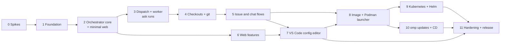

# Implementation plan

How to build AgentBot as specified in [requirements.md](requirements.md) and [architecture.md](architecture.md). The plan is ordered so that the risky unknowns are settled first, and every phase ends with something that runs.

## 1. Approach

- **Port, don't rewrite.** DevForge (`../DevForge`, commit `64ba5ca`) already implements most of the behaviour: Discord flows, the issue state machine, the CI gate, the agent host, the vault and the web pages. Each module is moved into its AgentBot component as mapped in architecture §3, with its tests, and then changed. Code is only written fresh where the architecture is new: dispatch and the run protocol, workers, checkouts and bundles, the launcher, the config workspace and the Helm chart.
- **Vertical slices.** Each phase ends with a smoke run of the real thing, not only unit tests. Phase 3 runs an `/ask` chat end to end; phase 5 takes an issue from label to merged PR.
- **Traceability.** Each phase lists the requirement IDs it delivers. A phase is done when those requirements are met and verified (§5).
- **Decisions before code.** The open questions in requirements §20 and architecture §11 are assigned to the phase that needs them (§6). A phase cannot finish with one of its questions still open.

## 2. Repository layout

```
package.json  bun.lock  tsconfig.json
src/
  cli.ts                  agentbot orchestrator|web|worker|launcher|health
  shared/                 config schema, protocol types, log, version and app identity, http/ws client helpers
  orchestrator/
    engine/               controller, scheduler, jobs, plans, chat, draft, ciGate, watches  (from DevForge src/engine, src/controller.ts)
    discord/              bot, access, progress, render, replies, topMessage, ompUpdate, outbound queue, watch channels
    github/               app, repos (installation listing, .agentbot.yml), poller, feedback, ci
    git/                  mirrors, push, git endpoint, bundle import, temp refs
    dispatch/             runs table, leases, worker WebSocket, relay, outbox, scale endpoint
    api/                  admin API, run artifact API, health endpoints
    configws/             config workspace: files, revisions, schemas, validation
    store/                db, vault, sessions, scratch, omp assets, omp runtime, sign-ins
  web/                    server, pages, admin API client, VS Code proxy, workspace sync
  worker/                 supervisor, checkout, checkpoint, result upload, cleanup
    host/                 agent host from DevForge src/agent: host, serve, session, tools, todos, oom, reap, loadout, scratchTools
  launcher/               rootless Podman client, spawn loop, reaper
extensions/agentbot-vscode/   bundled VS Code extension (WEB-28, WEB-31)
compose.yaml
deploy/
  helm/agentbot/
scripts/                  init-secrets.sh, omp-latest.ts, dry-run.ts
test/
  unit/  integration/  e2e/  fixtures/
```

One package and one image (architecture A-7). The VS Code extension builds to a `.vsix` that the image installs.

## 3. Phase 0: spikes

Each spike answers one question with a throwaway prototype and a short note in `wiki/spikes/`. A spike that fails switches to its fallback, and the requirement is changed before the phase that needs it starts. Outcomes: all six passed; their notes are `wiki/spikes/S1.md` to `S6.md`, and the requirement changes they caused are listed in architecture §10.

| # | Question | Method | Pass when | Fallback |
|---|---|---|---|---|
| S1 | Can omp's auth store route token refresh through the orchestrator (CRED-03)? | Read the omp SDK's `AuthStorage`/`discoverAuthStorage`; build a custom store whose refresh calls a callback. | A session in a separate process uses a refreshed token obtained only through the callback. | Short-lived access tokens only, without refresh tokens, in the run spec (architecture §11 item 4). |
| S2 | Does DevForge's agent host run unchanged in a separate container, with `Settings.init` once per process, a run-local auth store and a downloaded skills directory? | Copy `src/agent/*`, start the host in a container, feed it a `start` message by hand. | A plan-profile run completes with `yield`; `web_search` works. | Patch the host where it assumes the shared data directory. |
| S3 | Git over the internal API: a depth-1 fetch of one commit by sha through a Bun handler (`uploadpack.allowReachableSHA1InWant`, `uploadpack.hideRefs`), a bundle whose only prerequisite is that commit, and a fast-forward push from `refs/agentbot/runs/<id>`. | Bun server around `git upload-pack --stateless-rpc`; a script runs fetch, commit, bundle, import and push against a local bare "GitHub". | All five steps work from a shallow checkout, and a moved branch rejects the push. | Serve `git http-backend` as a CGI subprocess. |
| S4 | code-server lock-down (WEB-14, WEB-31): marketplace off, built-ins disabled, terminal closed by an extension, `nologin` shell. | Start code-server with those flags and env; try to open a terminal, run a task, install an extension. | All three attempts fail and are logged. | Accept a smaller lock-down and record the gaps in WEB-30. |
| S5 | KEDA `ScaledJob` with `metrics-api`, bearer auth and the `accurate` strategy behaves as in architecture §4.4. | `kind` cluster with KEDA ≥ 2.12, a fake `/internal/scale` and sleeping Job pods. | Pending 0 → 3 → 0 gives 3 pods, then none; nothing beyond `maxReplicaCount`. | Tune the strategy, or switch to `default` with a metric that counts running runs too. |
| S6 | Can the launcher, from a container, use the rootless Podman API socket: detect rootless, create a container with a secret, network, tmpfs, memory limit and `--rm`? | Small Bun client against the libpod REST API from inside a container. | A worker container starts, reaches a stub orchestrator on the network, and is removed when it exits. | Use `podman` CLI over the socket (`CONTAINER_HOST`). |

## 4. Phases



Phases 6 and 7 can run alongside 3 to 5 once phase 2 is done. Phase 8 needs phase 7, because the image bundles the VS Code extension.

### Phase 1: Foundation

**Goal:** an empty but real project with the shared pieces the components build on.

Work:
- Scaffold: `package.json` (Bun, TypeScript strict, `discord.js`, `octokit`, `zod`, `@oh-my-pi/pi-coding-agent` pinned), `tsconfig.json`, `cli.ts` with the role switch, and the `AGENTBOT_*` env loading (requirements §13).
- CI (OPS-04): typecheck, tests, Helm lint once the chart exists, and the version scheme.
- Shared code:
  - logging (OBS-02) and the rolling log (OBS-04), from `src/log.ts` and `src/rollinglog.ts`;
  - version and app identity (architecture §7.1), from `src/version.ts`.
- The settings schema (requirements §13), from `src/config.ts`, extended with:
  - `agent.name` and `labels.states.*`;
  - `workers.*`;
  - no per-repository settings: `repos[]` and `updates.*` removed; `discord.workChannelId`, `discord.watchCategoryId` and `github.mentionKeyword` added;
  - models for drafts and `/ask` (`models.chat`).
- Database (DB-01, DB-02), from `src/db.ts`, with the new tables: runs, the relay outbox, open questions, watches and their cursors, and config revisions.
- Vault (SEC-03 to SEC-05), from `src/vault.ts`, without the SSH blob.
- State machine (ISS-01 to ISS-06), from `src/state.ts`, with configurable labels (GH-08).

Ported tests: `config`, `vault`, `state`, `rollinglog`, `agentlog`.

**Exit:** `bun test` and the typecheck pass in CI. `agentbot orchestrator` starts, opens the database and reports `/livez`.

### Phase 2: Orchestrator core and minimal web

**Goal:** a configurable orchestrator that runs the Discord bot and the GitHub poller, with runs still faked.

Work:
- Controller and phases (ENG-01 to ENG-05), from `src/controller.ts` and `src/main.ts`. Engine restarts never touch runs.
- Health (OBS-01, architecture §4.5, RUN-12, RUN-13): `/livez`, `/readyz` with the limits block, and `AGENTBOT_WORKER_CAPACITY`.
- Admin API skeleton (`/internal/admin/*`, web token, SEC-14).
- GitHub (GH-01 to GH-25, GH-27), from `src/github/*`:
  - the label rename migration (GH-22 to GH-24);
  - repositories from the App's installations (GH-25);
  - polling for new work only in watched repositories, while following every tracked issue (GH-06, GH-10, GH-27).
- Discord (DSC-01 to DSC-20, DSC-22, DSC-24, DSC-29 to DSC-38), from `src/discord/*`:
  - `/forge` renamed to `/work`, and `work` to `start`;
  - the work channel, repo autocomplete, and `/work watch` and `/work unwatch` with channel creation (DSC-33 to DSC-38);
  - commands that track issues at once instead of waiting for a poll;
  - the agent nickname and name in text;
  - the outbound queue with coalescing and priorities (DSC-32).
- Scheduler and job state handling (JOB-01 to JOB-09), from `src/engine/scheduler.ts` and `jobs.ts`. `runAgent` goes through a `Dispatcher` interface whose only implementation in this phase is a test fake.
- The plan job (JOB-12 to JOB-17), driven by the fake dispatcher's canned plan output: the plan comment, the revision counter, and the "Plan ready for your approval" message with its three buttons. Phase 5 runs it on real workers.
- Minimal web, ported from `src/web/*` but talking to the admin API:
  - setup, login, account and sessions (WEB-01 to WEB-11);
  - a Settings form with typed channel IDs (dropdowns and the Repositories page come in phase 6);
  - the status page;
  - web `/healthz`.

Integration harness: a fake Discord surface, behind an interface between the engine and discord.js, and a fake GitHub (a small HTTP server that octokit points to through `baseUrl`). Both are built here and reused in later phases.

Ported tests: `access`, `discord`, `render`, `feedback`, `checks`, `ci`, `poller`, `scheduler`, `plans`, `controller`, `web`, `accounts`.

**Exit:** with a test Discord guild and a test repo:
- `/work watch` creates the repo's channel, and labelling an issue there opens a thread with the 📥 top message;
- `/work start` on an unwatched repo opens the thread in the work channel, and labelling an issue in an unwatched repo does nothing;
- the fake dispatcher's canned plan reaches "Plan ready for your approval";
- renaming the labels relabels open issues without cancelling them.

### Phase 3: Dispatch and worker, ask runs first

**Goal:** real runs on real workers, starting with `/ask`, which needs no repo checkout.

Work:
- Runs and leases (RUN-01 to RUN-05) and the `/internal/scale` endpoint.
- The worker WebSocket and protocol (architecture §4.2):
  - control messages;
  - relay of the host's IPC unchanged;
  - two-way sequencing and acks, and the outbox (RUN-06);
  - reattach after an orchestrator restart (RUN-07 to RUN-09).
- Discord state that survives restarts (RUN-14), delivery confirmations (RUN-15), and transcripts cut on the worker (RUN-16).
- Worker supervisor (architecture §2.3):
  - claim and heartbeat;
  - downloads: skills bundle and session;
  - the ported agent host as a child process (AGT-01 to AGT-29, minus the checkout parts);
  - reaping (AGT-06) and cleanup (RUN-20, the non-git part).
- Sign-ins (CRED-01 to CRED-05), following the S1 outcome.
- Ask scratch transfer: inputs, outputs and the `scratch-input` message (CHAT-07 to CHAT-11).
- `tool_call` relay for `create_issue` (AGT-10).
- `mcp-test` (AGT-21).
- Local development: `agentbot worker` runs as a plain process against a local orchestrator. The launcher comes in phase 8.

Ported tests: `agenthost`, `scratch`, `scratchTools`, `loadout`, `ompAssets`, `ompconfig`, `sessions`.

**Exit:** `/ask` with an attached file returns `answer.md` and an output file, with live progress and a to-do list. Then three failure checks:
- Killing the orchestrator mid-run: the run continues, re-attaches, and the status message keeps editing the same Discord message.
- Killing the worker: the chat fails with the worker-lost message.
- After the run, nothing of the run is left on the worker host.

### Phase 4: Checkouts and git

**Goal:** private checkouts on temporary branches, with results coming back as bundles.

Work:
- Mirrors and their runs repos on the state volume (WS-01, WS-02), from `src/git/workspace.ts`.
- The git endpoint (RUN-17): shallow fetch of the start commit, lease-token auth, protocol v2 and gzip, serving only the mirror, following the S3 outcome.
- Reading `.agentbot.yml` at dispatch (GH-26); worker checkout, the temporary branch `agentbot/run-<id>`, and `setupCommand` with `setup-output` (WS-03 to WS-05).
- Checkpoints every 5 minutes, on SIGTERM and before the result (RUN-18; JOB-10, JOB-11).
- Result (RUN-19): commit leftover changes, upload the bundle, check its prerequisite, import it, fast-forward push, and handle a branch that moved on GitHub.
- Temporary-ref cleanup and the start-up prune (RUN-20, WS-07, WS-08).
- Disk limit and its reporting (architecture STO-06).

Ported tests: `workspace` (rewritten for mirrors and bundles), and the S3 script turned into an integration test.

**Exit:** a fake implement run on a test repo pushes its commits to the issue branch. Three failure checks:
- Evicting the worker mid-run: the next worker resumes with the uncommitted file intact.
- A human push during the run: the job fails with the Retry message, and Retry starts from the new head.
- An implement run stopped by its time limit after committing: Retry continues with those commits and the uncommitted work intact.

### Phase 5: Issue and chat flows end to end

**Goal:** every user-facing flow on the new runtime.

Work:
- Implement (JOB-18 to JOB-20), the CI gate (CI-01 to CI-09), the PR (PR-01 to PR-03), revise and fix_ci (JOB-21 to JOB-23), from `src/engine/jobs.ts` and `ciGate.ts`, rebased on dispatch and bundles. The phase 2 plan job runs on real workers.
- `/work plan` (DSC-25 to DSC-28), `/work ask` (CHAT-01 to CHAT-06), `/work issue` drafts, `/work start`, `/work status` and `/work cancel`.
- Retry (DSC-21), idle replies (DSC-23), and restart semantics (JOB-08, NFR-03).
- Limits and time accounting that leave out worker start and checkout time (AGT-14, RUN-03, NFR-06).

Ported tests: `implement`, `ciGate`, `plans`, plus the integration flows on the fake surfaces.

**Exit:** on a real test guild and test repo:
1. Label an issue, approve the plan, wait for green push CI, see the PR open.
2. Leave a review comment containing the keyword and see the revise run push.
3. Merge the PR and see the thread archive.
4. Run `/work plan` → Execute, and `/work issue`, each through to its end.

The same scenario must pass with an orchestrator restart at each step.

### Phase 6: Web features

**Goal:** the full admin UI. This phase can run alongside phases 3 to 5.

Work:
- Repositories page with Watch and Unwatch (WEB-32), and channel and category dropdowns with permission checks (WEB-20 to WEB-24).
- Model sign-in (SEC-12, SEC-13), from `src/accounts.ts`, run in the orchestrator.
- omp page (AGT-20 to AGT-23).
- Skills page with `.zip` upload for skills (AGT-24 to AGT-26).
- Logs page and downloads (OBS-03, OBS-04).
- Status page sections: workers, limits, the Discord queue and setup time (OBS-05, OBS-06, NFR-06).
- Menu and theme (WEB-10, WEB-11).

**Exit:** a fresh install is configured entirely in the browser:
1. setup token;
2. admin account;
3. Discord and GitHub credentials;
4. the work channel chosen from the dropdown, and a repository watched from the Repositories page;
5. a model sign-in.

Each step shows validation errors where they apply.

Done: `test/integration/phase6.test.ts` runs the whole sequence through the served forms, against the orchestrator's admin API as `main.ts` composes it (`src/orchestrator/api/features.ts`, `src/web/pages.ts`), with Discord's REST API, GitHub and the provider sign-in faked. Decisions: the work channel is optional to save and required to start the engine (requirements §20 item 5); a save whose channels cannot be checked succeeds with a warning (item 6). The omp page shows the installed omp version only; update status and the manual check come with phase 10 (UPD).

### Phase 7: VS Code configuration editor

**Goal:** settings, omp settings, skills and agents editable as files.

Work:
- Config workspace API in the orchestrator:
  - masked `settings.json` and `omp.json`;
  - skills and agents trees;
  - per-file revisions;
  - JSON Schemas generated from the zod schemas;
  - change notifications (WEB-25, WEB-26).
- Web sync watcher (WEB-26, WEB-27): debounced push, pull on change, `.remote` conflict files, a queue while the orchestrator is offline, and removal of `tasks.json` and `launch.json`.
- Bundled extension (WEB-28, WEB-31): status bar, Problems panel entries, the two commands, and the terminal block.
- code-server start-up and lock-down (WEB-14, WEB-30, WEB-31), following the S4 outcome.
- Logging of every applied change (WEB-29).

**Exit:**
- Editing a skill in VS Code is used by the next run.
- An invalid `settings.json` shows its errors in the Problems panel and changes nothing.
- Editing the same setting on the Settings page and in VS Code produces a `.remote` conflict.
- No terminal, task or extension install works.

Done: `test/integration/workspaceSync.test.ts` covers the first three points against the real admin API (`src/orchestrator/api/workspace.ts`, `src/web/workspace/`). `test/e2e/vscode/` (Containerfile + `smoke.sh`) builds the S4 layout with the bundled extension (`vscode/extension`, `bun run build:vsix`) and runs the web role with an orchestrator. In a browser, an invalid `settings.json` showed the AgentBot error at its line in the Problems panel and the file stayed unapplied. The terminal keybinding, Terminal: Create New Terminal, the tasks commands, Install from VSIX and Install Extension from Location were all blocked. The Marketplace search was empty, a written `.vscode/tasks.json` was deleted, and no shell process ran. Phase 8 reuses the Containerfile's code-server layer. Deviations from S4: code-server's `HOME` is `AGENTBOT_HOME`; the lock-down log goes to the extension's output channel rather than `~/agentbot-lockdown.log`; `state.vscdb.backup` is deleted with `state.vscdb`.

### Phase 8: Image and Podman launcher

**Goal:** the Podman stack runs the whole system, with one container per run.

Work:
- Dockerfile: one image, four roles, `/app/IDENTITY`, the `nologin` login shell, code-server with the `.vsix`, and the npm-latest omp with fallback to the pin (UPD-01), from `scripts/omp-latest.ts`.
- Launcher (LCH-01 to LCH-04), following the S6 outcome.
- `compose.yaml` and `scripts/init-secrets.sh` (OPS-01 to OPS-03, architecture §7.2).
- Health commands (`agentbot health`) and per-worker memory and disk limits (NFR-01, NFR-02).

**Exit:** on a clean Podman host, the phase 5 scenario passes with `podman compose up`. During a run `podman ps` shows one worker container per run, and none once the runs end. A rootful socket is refused.

Done (on the rootless Podman 6.1.4 machine, Fedora CoreOS, docker-compose 5.6.0 and podman-compose 1.6.0 as providers): `test/e2e/compose/smoke.sh` brings the stack up healthy in ~17 s, creates the admin through `/setup`, and runs a real worker run without Discord, GitHub or a model (an MCP "Test connection" against an inline stdio server). `podman ps` showed one worker container for it and none afterwards; the launcher image refused the rootful socket with exit 2. `test/e2e/launcher/smoke.sh` covers capacity (3 runs, capacity 2) and the reaper. Measured during the smoke (idle, not a heavy run): orchestrator ~280 MB, web ~25 MB without code-server, launcher ~16 MB, a worker 110–145 MB. **Not yet run:** the phase 5 scenario on a real test guild and repo under compose; it needs a Discord bot token and guild, a GitHub App on a test repo, and a model sign-in. Decisions: compose secrets are `file:` secrets made by `scripts/init-secrets.sh` (docker-compose refuses `external:` secrets), with the worker token also stored as the Podman secret workers receive; all three services run with `keep-id:uid=10001,gid=10001` so 10001 can read its 0400 secret files; worker run-local storage moved under `AGENTBOT_WORKER_RUN_DIR` (tmpfs), checkout and bundles on container storage; until settings are saved, the dispatcher still admits MCP tests (`dispatchLimits`).

### Phase 9: Kubernetes

**Goal:** the same system on Kubernetes, with 0 to 10 worker pods.

Work:
- Helm chart (OPS-07, OPS-08, architecture §7.3):
  - orchestrator Deployment (`Recreate`), web Deployment, Services and optional Ingress;
  - the `ScaledJob` and `TriggerAuthentication`, using the S5 settings;
  - PVCs, generated secrets with `lookup`, NetworkPolicies (SEC-15), resources;
  - a check that fails when the KEDA CRD is missing.
- CI: `helm lint`, `helm template` and a `kind` install test.

**Exit:** on `kind` with KEDA, 10 issues queued with limits raised to 10 run on 10 pods, and pods drop to 0 afterwards. Health reports the limits and the warning while limits are below capacity. Killing a pod resumes the job on a new one.

Done on kind (Kubernetes 1.34, KEDA 2.21.0, podman provider) with `bun test/e2e/k8s/scenarios.ts`. It uses a derived test image (`test/e2e/k8s/Containerfile`) whose orchestrator runs the real internals with fake Discord and GitHub (`test/e2e/k8s/orchestrator.ts`) and whose workers use the fixture agent host. The chart is unchanged apart from the image values.
- **A:** 10 issues gave 10 worker pods 7 s after filing, and no extra pods. All 10 plans succeeded, and all pods and Jobs were gone 62 s after the last one (the Job TTL).
- **B:** with limits 2/2 and capacity 10, `/readyz` showed the limits and the warning "at most 4 workers will be used", and web `/healthz` relayed the limits.
- **C:** after `kubectl delete pod` mid-implement, the run was marked lost after the 45 s lease. A new pod claimed the resumed run 49 s after the kill and finished it with the first run's commit and its uncommitted file restored.

`test/e2e/k8s/install-smoke.sh` runs the real image: the KEDA-missing failure, the NetworkPolicy checks, secrets kept across `helm upgrade`, and an MCP test run on one Job pod. `test/integration/helm.test.ts` covers the rendering, and `test/integration/k8sharness.test.ts` runs the scenario orchestrator without kind.

Fixed along the way: a lost implement run's re-queued job now resumes from the uploaded checkpoint and session (`implementRun`). Before, it decided resumption from `issue.impl_session`, which a lost run never writes.

### Phase 10: omp updates, CD and tooling

Work:
- In-place omp updates for workers (UPD-02 to UPD-10): install, pack, canary and fallback, cleanup, and Discord notices, from `src/ompUpdate.ts` and `src/discord/ompUpdate.ts`.
- CD (OPS-05): a deploy job for each target, which waits for the matching version in health.
- `dry-run` (OPS-06), from `scripts/dry-run.ts`.

**Exit:**
- Approving an update makes the next worker use the new omp, while running workers keep the old one.
- A deliberately broken copy falls back and re-offers the update.
- CD deploys a tagged build to the test cluster and the Podman host.

Done:
- **Updates.** `test/integration/ompUpdate.test.ts` covers the first two points with the real dispatcher, the internal API, worker processes, fake Discord, a fake npm registry and a real packed archive. `test/e2e/omp-update/real-install.ts` installed npm's latest omp over the pin on the host and inside the image, packed it (~270 MB archive, ~950 MB unpacked), and started an agent host from the copy up to `registered`.
- **Not yet observed in a deployed stack:** an approved update reaching a real model-backed run. That needs Discord and a model.
- **CD.** `.github/workflows/cd.yml` passes actionlint. `deploy/k8s/deploy.sh` and `deploy/podman/deploy.sh` deployed, upgraded and rolled back locally (kind, and rootless Podman on the macOS client and in the Fedora CoreOS VM with the systemd unit), checking the version in both health endpoints (`test/e2e/deploy/smoke.sh`).
- **Not yet run on GitHub:** the `workflow_run` trigger, GHCR pulls and the self-hosted runner.
- **dry-run.** `bun run dry-run` planned against a temp repo with a real model, answered a question from stdin, and cleaned up (`test/integration/dryrun.test.ts` uses the fixture host).

### Phase 11: Hardening and release

Work:
- Resolve the remaining open questions (§6).
- Chaos tests: kill the orchestrator, web, launcher or a worker at random points during the phase 5 scenario; fill a worker's disk; trigger an OOM.
- Load test: 10 concurrent implement runs on the same repo and on different repos, while watching the Discord queue (DSC-32) and the startup time of each run (NFR-06).
- Security review against architecture §6: token scopes, lease expiry, the web pod contents, NetworkPolicies.
- Documentation: README with install for Podman and Kubernetes, configuration, and upgrade.

**Exit:** all requirements verified (§7). A tagged release is published, then deployed by CD to both targets.

Load test done on kind with `bun test/e2e/k8s/load.ts` (`wiki/load-test.md`). Both scenarios succeeded: 10 concurrent implement runs on one repository, then 10 on 10 repositories, each pushing its own branch and opening a PR. At 10 concurrent runs, NFR-06 setup (claim → agent registered) was 7–9 s p50 and 10–14 s p95. The Discord queue peaked at 11 writes, the oldest 15 s old (10 issues sharing one watch channel). It fixed three bugs: package-manager caches on the run-local tmpfs (ENOSPC), event-loop stalls from SQLite fsyncs (`synchronous=NORMAL`), and false watch suspensions from the cached repository listing.

Chaos tests done on the rootless compose stack with `bun test/e2e/chaos/run.ts` (manual, needs the podman machine). The fake GitHub runs as its own service and the fake Discord persists its state, so both outlive restarts. Three seeded rounds passed (seeds 11, 4242 and 20261030), each taking 4 issues through the phase 5 flow while 15 to 30 random SIGKILLs hit the orchestrator, web, the launcher and workers. Every issue finished with one PR, no duplicated comment, message or push, no unfinished run and no worker left. The limits round passed too: a full 2 MiB checkout and a real kernel OOM kill (512 MiB worker) were each reported for their own run only. The tests found two bugs. Workers had no liveness check on their orchestrator connection: an orchestrator restarted with a new address left them half-open, and every one of their runs was lost. They now ping, and drop silent connections and hung connection attempts (`src/worker/connection.ts`). Disk limits under 1 GiB printed as "0.0 GiB".

## 5. Verification

| Level | What | Where |
|---|---|---|
| Unit | Pure logic: state machine, feedback rules, CI verdicts, settings and workspace validation, protocol sequencing, bundle checks, rendering. | `test/unit`, run in CI on every push. |
| Integration | Orchestrator, worker and web together against the fake Discord surface, fake GitHub and a local bare repo; also the git endpoint and the outbox and reattach logic. | `test/integration`, run in CI. |
| End to end | Real Discord test guild, real GitHub test repo with a GitHub App and Actions CI, on Podman and on `kind`. | `test/e2e`, run nightly and before every release. Needs the secrets of a test guild and test app. |
| Chaos | Process kills, evictions, disk and memory pressure during the e2e scenario. | Phase 11, and before every release. |

DevForge's tests are ported with their modules. Tests that pinned DevForge's wording or single-process wiring are deleted, not adapted. New permanent tests cover behaviour at the boundaries: protocol replays, conflicting edits, moved branches, lease expiry and limit warnings.

## 6. Open questions and when they must be settled

| Question | Source | Settle by |
|---|---|---|
| Capacity check before thread creation for `/work ask` and `/work plan` | requirements §20 item 1 | settled in phase 5: refused up front |
| `/work cancel` in chat threads | requirements §20 item 2 | settled in phase 5: stops the live run |
| Strict schema for revise and fix_ci output | requirements §20 item 3 | settled in phase 5: strict |
| Enforcing read-only planning beyond the prompt | requirements §20 item 4 | settled in phase 5: prompt only, writes discarded (WS-04) |
| Releasing workers while waiting for an answer | architecture §11 item 1 | after release: the phase 11 load test showed no worker shortage at capacity 10, so it is not a release blocker |
| Moving DevForge's on-prem host to this stack | architecture §11 item 2 | settled in phase 10: compose under a systemd user unit, deployed by CD on a self-hosted runner (architecture §7.2, §7.4) |
| Web replicas | architecture §11 item 3 | not needed for release |
| omp refresh hook | architecture §11 item 4 | settled by spike S1 (`wiki/spikes/S1.md`) |
| Per-repo dependency cache | architecture §11 item 5 | settled in phase 11: not needed for release (`wiki/load-test.md`); revisit when a repository's average setup time exceeds ~60 s |
| Agent host in a separate container from the supervisor | architecture §11 item 6 | settled in phase 11: not a release blocker; the interim fix (claims bound to the worker's network address, security finding F1) shipped, and the split is the first change after release (`wiki/verification.md`, Phase 11 security review) |
| Size of the packed omp copy | architecture §11 item 7 | settled in phase 10: 269 MB packed, 950 MB unpacked; cache per node only if downloads become a problem |

## 7. Requirement coverage

| Requirements | Phase |
|---|---|
| ISS, GH-01 to GH-25, GH-27, DSC-01 to DSC-20, DSC-22, DSC-24, DSC-29 to DSC-38, JOB-01 to JOB-09, JOB-12 to JOB-17, ENG, DB, WEB-01 to WEB-11, OBS-01, OBS-02, SEC-01 to SEC-06, SEC-14, RUN-10 to RUN-13, OPS-04 | 1, 2 |
| RUN-01 to RUN-09, RUN-14 to RUN-16, AGT-01 to AGT-29, CRED, CHAT-07 to CHAT-11 | 3 |
| WS, GH-26, RUN-17 to RUN-21, STO, JOB-10, JOB-11 | 4 |
| JOB-18 to JOB-23, CI, PR, DSC-21, DSC-23, DSC-25 to DSC-28, CHAT-01 to CHAT-06, NFR-03, NFR-06 | 5 |
| WEB-20 to WEB-24, WEB-32, SEC-12, SEC-13, OBS-03 to OBS-06 | 6 |
| WEB-14, WEB-25 to WEB-31 | 7 |
| OPS-01 to OPS-03, LCH, UPD-01, SEC-16, NFR-01, NFR-02 | 8 |
| OPS-07 to OPS-09, SEC-15, and the Kubernetes side of RUN-10 to RUN-13 | 9 |
| UPD-02 to UPD-10, OPS-05, OPS-06 | 10 |
| NFR-04, NFR-05, everything re-verified | 11 |

Withdrawn requirements (WEB-12, WEB-13, WEB-15 to WEB-19, SEC-07 to SEC-11, CRED-04, STO-05) need no work. Where DevForge implements them, the code is not ported.

The evidence and status of every requirement ID, with the open gaps ordered by risk, are in [`wiki/verification.md`](verification.md).

## 8. Risks

| Risk | Effect | Mitigation |
|---|---|---|
| omp stops routing token refresh through `refreshOAuthCredential` (S1 passed on 18.12.1) | CRED-03 breaks after an omp upgrade | Port the S1 script into `test/integration`, asserting workers make no token-endpoint requests. |
| omp changes its SDK between versions | The agent host breaks after an in-place update | Pin in `package.json`, CI on the pin, canary and fallback (UPD-08). |
| Worker start, clone and `setupCommand` are slow | Chats feel slow; jobs take longer | Measure in phase 5 (NFR-06); dependency cache in phase 11 if needed. |
| code-server lock-down has gaps (S4) | VS Code can still start programs | Already accepted as admin-level access (WEB-30); record the gaps found. |
| Discord rate limits with 10 concurrent runs | Delayed or dropped status edits | Shared outbound queue (DSC-32); measured in the phase 11 load test. |
| KEDA scaling behaves differently from the spike | Too few or extra pods | Extra pods exit after the claim timeout; S5 settings tested again in phase 9. |
| Rootless Podman differs across hosts | The launcher fails on some hosts | Rootless check at start (LCH-01); Podman ≥ 4.6 documented. S6 ran on one distribution only (Fedora CoreOS 44, Podman 6.1.4, SELinux enforcing); test a second one in phase 8. |
