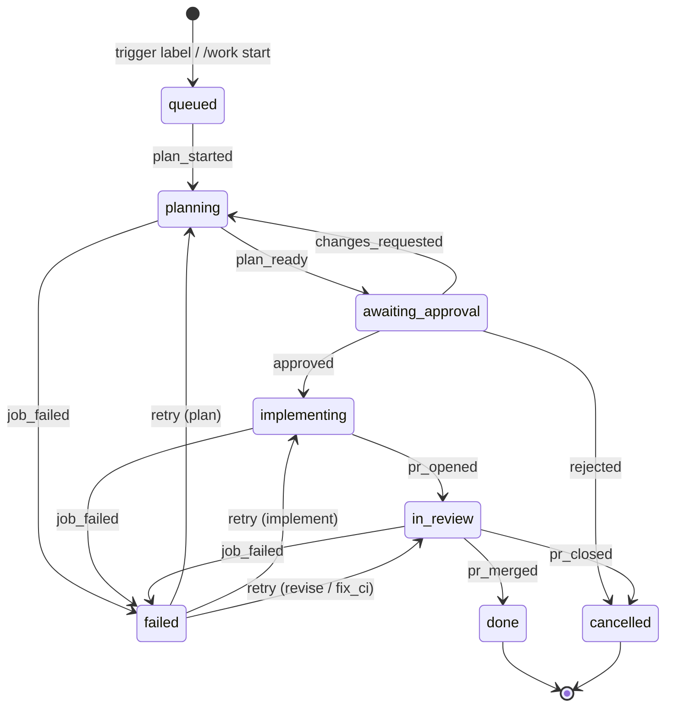

# Requirements

Requirements for AgentBot. Open questions are listed in §20.

The key words MUST, MUST NOT, SHOULD, SHOULD NOT and MAY are used as in RFC 2119. Requirement IDs are stable; append new ones and do not renumber.

Naming: the agent's name and the GitHub label names are configurable (DSC-29, GH-22). Quoted messages, comments and labels in this document show the defaults; wherever such text names the system, it uses the configured `agent.name`.

Topology: AgentBot runs as separate components (web, orchestrator, one short-lived worker per agent run and, on Podman, a launcher), described in [architecture.md](architecture.md). Each worker works in a private checkout on a temporary branch and is deleted when its run ends. Requirements prefixed RUN-, STO-, CRED-, LCH-, SEC-14 to SEC-16 and UPD-06 to UPD-10 are defined there. "The engine" in this document means the orchestrator's engine state machine (ENG-01), which runs inside the orchestrator process. Restarting the engine never restarts the process and never aborts runs on workers.

## 1. Purpose and scope

The system is a long-running service that uses an embedded coding-agent SDK (omp, `@oh-my-pi/pi-coding-agent`) to develop and maintain the GitHub repositories its GitHub App is installed on.

- GitHub issues drive the work.
- Discord is the control surface: approvals, answers to agent questions, steering, chat and status.
- A password-protected web UI handles configuration and operations.
- Humans approve plans and merge pull requests. The system never merges.

Any non-terminal state also accepts `cancelled`.

### Actors

| Actor | Capabilities |
|---|---|
| Admin | Owns the web UI account. Configures everything, manages model accounts, skills and agents, omp settings. |
| Allowed member | A Discord user listed in `allowedUserIds` or holding a role in `allowedRoleIds`. Can use every `/work` command, every button and modal, and steer runs. |
| Public user | Any Discord user in an ask-only channel. Can use `/ask` there and follow up in the threads they started. |
| GitHub collaborator | Applies the trigger label and reviews PRs. Feedback counts only from OWNER, MEMBER or COLLABORATOR. |
| Agent | An omp session. It never holds GitHub or Discord credentials. |

## 2. GitHub integration

- **GH-01** The system MUST authenticate as a GitHub App using installation tokens. The required permissions are Contents RW, Issues RW, Pull requests RW, Checks R, Actions R and Metadata R. Workflows permission MUST NOT be required.
- **GH-02** At engine start the system MUST validate the App private key. The key must be a whole RSA private-key PEM: BEGIN and END lines first and last, parseable, and RSA. The error MUST name the likely mistake: a public key, an OpenSSH key, missing header lines or a damaged body. Saving Settings with a bad key MUST be rejected with HTTP 400, and nothing is stored.
- **GH-03** The system MUST look up a repository's installation on first use and cache it. A repository the App cannot access MUST be refused, with a message that names it and links to the App's installation page.
- **GH-04** The commit identity MUST be `<slug>[bot]` with email `<id>+<slug>[bot]@users.noreply.github.com`.
- **GH-05** GitHub MUST be polled, not driven by webhooks. The interval is `github.pollIntervalSeconds` (default 60), and the first cycle MUST run immediately at start.
- **GH-06** Each poll cycle MUST look for new work in the watched repositories one after another (GH-10), then follow every tracked issue, whatever its repository (GH-13 to GH-21). An error MUST NOT stop the other repositories or issues. It MUST be recorded on the watch as `lastError` when the repository is watched, and otherwise on the affected issue's status row, and always in the log.
- **GH-07** A `pollNow(repo)` request MUST join a cycle that is already running and resolve when a cycle started after the request completes. When the poller is stopped, it MUST resolve immediately.
- **GH-08** The trigger label and the state labels MUST be configurable (GH-22). The default trigger label is `agentbot`. The default state labels are `<trigger>:planning`, `<trigger>:awaiting-approval`, `<trigger>:implementing`, `<trigger>:in-review` and `<trigger>:failed`. The `queued`, `done` and `cancelled` states MUST carry no state label. Missing labels MUST be created.
- **GH-09** A state change MUST remove the previous state label (a 404 is ignored) and add the new one. If labels are unchanged, nothing is sent. A label sync failure MUST be logged and MUST NOT fail the transition.

### 2.1 New work

- **GH-10** For each **watched** repository (DSC-35), each cycle MUST list open issues that carry the trigger label and were updated since that repository's cursor, excluding pull requests. The cursor then advances to the newest `updated_at` seen. A newly watched repository starts with no cursor, so issues already labelled are picked up.
- **GH-11** The system MUST skip issues it already tracks and issues whose body contains the marker `<!-- agentbot:plan-thread -->`. That marker is used by issues that `/work plan` Execute files and tracks itself.
- **GH-12** For each new issue the system MUST do the following, in order:
  1. Post a top message `📥 **#n title** — <url>` in the repository's watch channel (DSC-34).
  2. Start a thread from that message, named `#n title` (at most 100 characters), with one-week auto-archive.
  3. Record the issue as `queued` together with its thread.
  4. Post a "Queued for planning" message in the thread.
  5. Enqueue a `plan` job.

  If the queued message fails to post, the system MUST log a warning and keep tracking the issue.

### 2.2 Cancellation and completion

- **GH-13** If a tracked, non-terminal issue without a PR is closed, or loses the trigger label, it MUST be cancelled. The reason is `issue closed` or `` `<trigger>` label removed ``.
- **GH-14** For an `in_review` issue, the system MUST first cancel the issue's queued jobs and abort its live session. Then:
  - If the PR was merged, the issue MUST move to `done` and the thread MUST get a "🎉 Complete" message.
  - If the PR was closed without merging, the issue MUST move to `cancelled` and the thread MUST get a "⏹️ Stopped" message.

  In both cases terminal cleanup (WS-08) follows.

### 2.3 Review feedback

- **GH-15** Review feedback MUST be evaluated only for `in_review` issues with a PR, and only when the issue has no queued or running job.
- **GH-16** A feedback item MUST come from an author with association OWNER, MEMBER or COLLABORATOR. Authors that are bots, including the system's own bot, MUST be ignored. Items are:
  - **Reviews.** A review with an empty body counts only when its state is `CHANGES_REQUESTED`. Key: `review:<id>`.
  - **Inline review comments.** Each item carries the path, line and diff hunk. Key: `rc:<id>`.
  - **PR conversation comments.** These count only when the body contains `github.mentionKeyword` (default `/agentbot`). Key: `ic:<id>`.
- **GH-17** An item that has been seen MUST NOT trigger again. New items MUST enqueue one `revise` job, and post-PR CI evaluation MUST be skipped in that cycle.

### 2.4 CI after the PR is open

- **GH-18** For `in_review` issues, the system MUST evaluate the check runs on the PR's head SHA. It does so only when all checks have completed and the SHA differs from the last SHA it attempted (`ci_last_sha`).
- **GH-19** A check fails when it ends `failure` or `timed_out`. `skipped` and `neutral` MUST count as passing.
- **GH-20** On a failing check:
  - If `ci_attempts` is below `maxCiFixAttempts` (default 3), the system MUST collect the failure logs and enqueue `fix_ci`.
  - If attempts are exhausted, it MUST record the SHA and post a single "CI is still failing after N fix attempts — this needs a human" message.
- **GH-21** Failure logs MUST be fetched only for GitHub Actions check runs, keeping the last 300 lines of each.

### 2.5 Label names

- **GH-22** The admin MUST be able to set `labels.trigger` and each state label (`labels.states.planning`, `awaitingApproval`, `implementing`, `inReview` and `failed`). An unset state label defaults to its name derived from the current trigger (GH-08). Each name MUST be 1–50 characters (GitHub's limit). All six names MUST be distinct, compared case-insensitively as GitHub does. Invalid names MUST be rejected on save.
- **GH-23** The system MUST store the label names it last applied. On the first engine start after the names change, before the first poll cycle, it MUST relabel every tracked issue that is not terminal: add the new trigger label and the new state label, and remove the old ones. Renaming labels MUST NOT cancel any issue: GH-13 MUST judge an issue by the current trigger name only after it has been relabelled. A failed relabel MUST be logged and retried on the next cycle.
- **GH-24** The system MUST NOT delete or rename labels in the repo. Old labels stay in the repo for a human to remove. Issues that carry only the old trigger label and are not tracked MUST NOT be picked up.

### 2.6 Repositories

- **GH-25** The repositories available to AgentBot MUST be exactly those the GitHub App's installations can access. There are no per-repository settings in AgentBot. An admin widens or narrows the set in the App's installation settings on GitHub. Archived repositories are listed on the Repositories page but cannot be watched or worked on. They are not offered in autocomplete, and `/work` commands that name one are refused with "archived (read-only)".
- **GH-26** A repository MAY carry its own configuration in `.agentbot.yml` on its default branch (at most 64 KiB):
  - `baseBranch`: the branch work starts from and PRs target; default: the repository's default branch;
  - `setupCommand`: run in the worker's checkout before the agent starts (WS-05).

  The orchestrator reads the file through the GitHub API when it dispatches a run. A missing file means defaults. An invalid file (bad YAML, unknown keys, wrong types) MUST stop the run before it starts. The thread then gets "`.agentbot.yml` is invalid: <reason>", and a Retry button where the run is a job.
- **GH-27** Repositories that are not watched MUST NOT be searched for new labelled issues. Labelling an issue there does nothing. Work on them starts only from `/work` commands. An issue tracked by a command MUST be followed until it ends, whether or not its repository is watched. That covers cancellation, review feedback, CI and merge.

## 3. Issue lifecycle

- **ISS-01** An issue MUST be in exactly one of these states: `queued`, `planning`, `awaiting_approval`, `implementing`, `in_review`, `done`, `failed` or `cancelled`. Only `done` and `cancelled` are terminal.
- **ISS-02** The allowed transitions MUST be exactly those in the §1 diagram. Any other event MUST be rejected as an illegal transition.
- **ISS-03** `retry` from `failed` MUST return to the state of the failed job's kind: plan → `planning`, implement → `implementing`, revise or fix_ci → `in_review`.
- **ISS-04** Approval MUST move the issue directly to `implementing`. No separate implementation-started event exists.
- **ISS-05** A failed `plan` or `implement` job, or a failed `revise` with no PR yet, MUST leave the issue in `failed` and offer a Retry button. A job failure on an issue that is already terminal MUST NOT change its state.
- **ISS-06** Every state change MUST be persisted and logged. It MUST also update the leading icon of the thread's top message: 📥 queued, 🛠️ planning or implementing, 📋 awaiting approval, 👀 in review, ✅ done, ❌ failed, ⏹️ cancelled.

## 4. Jobs and scheduling

- **JOB-01** Job kinds MUST be `plan`, `implement`, `revise` and `fix_ci`. Job statuses MUST be `queued`, `running`, `succeeded`, `failed` and `cancelled`.
- **JOB-02** At most `limits.maxConcurrentJobs` jobs (default 2) MUST run at once across all issues. Each issue MUST have at most one running job.
- **JOB-03** The scheduler MUST atomically claim the oldest queued job whose issue has no running job. Enqueuing a job and finishing a job MUST each trigger a scheduling pass.
- **JOB-04** A job's cost MUST be the sum of its agent runs (OBS-05).
- **JOB-05** Cancelling an issue MUST:
  1. Cancel its queued jobs.
  2. Abort its live session.
  3. If the issue is non-terminal, move it to `cancelled` and run terminal cleanup with a "⏹️ Cancelled — <reason>" message.
- **JOB-06** Before an agent run, the job MUST check that its issue still exists and is not terminal. If either check fails, the job ends as cancelled. A job whose issue has no Discord thread MUST fail.
- **JOB-07** Agent runs MUST stop at these limits:

  | Limit | Default |
  |---|---|
  | `planMinutes` | 30 |
  | `implementMinutes` | 120 (also used by revise) |
  | `fixMinutes` | 45 |
  | `maxCostUsdPerJob` | $15 |

  Exceeding a limit MUST fail the job with a message that names the limit.

### 4.1 Restart and resume

- **JOB-08** At start, the orchestrator MUST re-attach runs still on workers and treat the ones not re-attached as lost (architecture RUN-04, RUN-07). A lost issue job is requeued once with `resume: true`. Orchestrator shutdown MUST NOT abort runs on workers (RUN-09).
- **JOB-09** A resumed job MUST NOT repeat a step that is already externally visible, such as publishing the plan, pushing, or opening the PR. It MUST only complete the state update.
- **JOB-10** The session file MUST be kept by the orchestrator between runs. The worker uploads it as soon as it is created, at every checkpoint and at the end of the run (architecture RUN-18, RUN-19). A resumed job MUST continue that session and start with a restart note. The note tells the agent to inspect `git status` and `git log` (which show only the start commit and the run's own commits, AGT-13) and carry on.
- **JOB-11** A resumed or retried implement job MUST restore the run's commits and its uncommitted work from the last checkpoint (architecture RUN-17, RUN-18), so that the work survives the loss of a worker or a failed run.

### 4.2 Plan job

- **JOB-12** The plan job MUST fire `plan_started` before any checkout or GitHub work, so that early failures land in `failed` with Retry.
- **JOB-13** The plan job MUST:
  1. Fetch the mirror and run on a worker with a private checkout of the base branch (architecture RUN-17).
  2. Read the issue and its comments, excluding the plan comment. Each comment is truncated to 4000 characters.
  3. Run the `plan` profile with `models.plan`.

  A revision (after "Request changes") MUST resume the plan session and give the latest plan and the requested changes as input.
- **JOB-14** The plan output `{summary, planMarkdown, complexity: small|medium|large}` MUST be stored on the job before it is published. `plan_rev` MUST increase by 1 for each plan.
- **JOB-15** The plan MUST be posted to the issue as a single comment that is edited on each revision. The comment starts with `<!-- agentbot:plan -->` and has the heading `## AgentBot plan (rev N)`.
- **JOB-16** The thread MUST receive the message "Plan ready for your approval". It includes the rev, the complexity, a link to the comment, the summary, the full plan attached as `plan-rev<N>.md`, and the buttons **Approve**, **Request changes** and **Reject**. The message MUST mention the allowed users.
- **JOB-17** The buttons MUST act only on the current rev. A stale click MUST get the reply "This plan is no longer current."
  - **Request changes** opens a modal with required feedback.
  - **Approve** enqueues `implement`.
  - **Reject** removes the trigger label, comments on the issue, and cancels it.

### 4.3 Implement job

- **JOB-18** A fresh implement job MUST start from a fresh checkout of the base branch (architecture RUN-17). It runs the `implement` profile and gives the approved plan as input.
- **JOB-19** The agent MUST commit but MUST NOT push. When the agent finishes:
  - the worker commits any leftover changes as `AgentBot: remaining changes for #N` and uploads its temporary branch as a bundle, or reports that the branch has no new commits, since git cannot create an empty bundle (architecture RUN-19);
  - the orchestrator fails the job with "Agent produced no commits" when the worker reports no new commits;
  - otherwise the orchestrator pushes the commits to `refs/heads/<branch>` as a fast-forward and verifies that the remote branch exists.

  When the run fails with a time or cost limit or an error, its bundle and last checkpoint MUST be kept, not pushed, so that Retry continues from them (DSC-21, architecture RUN-20). When the push is rejected because the branch moved on GitHub, the bundle is discarded and Retry starts from the new head (architecture RUN-17, RUN-19).
- **JOB-20** The output MUST be `{prTitle, prBody, testing}`.

### 4.4 CI gate before the pull request

- **CI-01** After pushing, the system MUST decide whether the repo has push CI for the branch. A workflow counts when it:
  - is active;
  - is not under `dynamic/` (CodeQL, Dependabot);
  - has a `push` trigger whose `branches` or `branches-ignore` filters match the branch.

  `paths` and `paths-ignore` MUST NOT be evaluated. A workflow whose YAML cannot be parsed MUST count. If no workflow counts, the PR MUST open immediately.
- **CI-02** Otherwise the issue MUST stay `implementing` and the thread MUST show "Waiting for CI on `<branch>`". The system MUST poll the check runs and workflow runs of the branch's current head every `pollIntervalSeconds`. A new head MUST be followed, and the start-grace clock MUST reset for it.
- **CI-03** Only current runs MUST count:
  - per `(workflow_id, event)`, the run with the highest `run_number`;
  - check runs of a superseded workflow run are dropped;
  - per (check suite or app, name), the check run with the highest id.
- **CI-04** The verdict MUST be one of:
  - `none`: no checks and no workflow runs.
  - `pending`: anything is still incomplete.
  - `failed`: any `failure` or `timed_out` check, or, when there are no checks, a failed workflow (including `startup_failure`).
  - `cancelled`: any cancelled run. This is neither success nor failure, and the system keeps waiting on the current head.
  - `passed`: everything else. `skipped` and `neutral` count as passing.
- **CI-05** If no check run or workflow run appears within 5 minutes of the push, the PR MUST open with a note that no CI ran.
- **CI-06** Each wait MUST be bounded by `limits.ciWaitMinutes` (default 60) per push, and the wait MUST NOT count toward `implementMinutes`. On timeout the PR MUST open with a note, and post-PR CI watching (GH-18) takes over.
- **CI-07** On `failed`, the system MUST resume the implement session with the failure logs (fix run, `fixMinutes`) and then push and wait again. These attempts MUST share the issue's `ci_attempts` counter with post-PR fixes, bounded by `maxCiFixAttempts`.
  - If attempts are exhausted, the job MUST fail with a "needs a human" message and a Retry button. No PR is opened.
  - If a fix run pushes nothing, the job MUST fail.
- **CI-08** The wait state MUST be checkpointed: SHA, first-seen time, wait start, fixes and retry grant. A restart or Retry MUST resume from the checkpoint without a new agent run, push or PR. Retry MUST restart the time bounds, allow one extra fix attempt, and wait on the branch's current head, which may include a human's push. A fix interrupted after its push MUST be detected because the head has moved past the failing SHA.
- **CI-09** `/work cancel` MUST stop the wait.

### 4.5 Pull request

- **PR-01** The PR MUST use the issue branch as head and the repository's base branch (GH-26) as base. The title is `prTitle`. The body contains, in order:
  - the agent's body;
  - an optional OOM warning;
  - a `### Testing` section;
  - an optional `### CI` note;
  - `Closes #<issue>`;
  - a link to the plan comment.
- **PR-02** The PR number MUST be recorded before the `pr_opened` event fires.
- **PR-03** The thread MUST receive "Implementation complete" with the PR link, the title, the body (truncated), testing, the CI line and next steps.

### 4.6 Revise and fix_ci

- **JOB-21** A follow-up run MUST start from a fresh checkout of the issue branch's current head (architecture RUN-17).
  - `revise` resumes the implement session with the feedback items as input and outputs `{summary}`.
  - `fix_ci` resumes it with the failing checks and their logs.
- **JOB-22** The worker MUST commit any leftover changes as `AgentBot: follow-up changes for #N` in its result bundle. The orchestrator pushes the bundle as a fast-forward when it has new commits; when the worker reports no new commits instead of a bundle, no code changes were needed.
  - On success, revise MUST comment "AgentBot addressed feedback: 
" on the PR and mark its items as seen.
  - A failed revise MUST still mark its items as seen, and Retry re-runs the same items.
- **JOB-23** A non-resumed `fix_ci` MUST increment `ci_attempts` and set `ci_last_sha`. A resume MUST NOT increment it. If the fix pushes nothing, the system MUST comment on the PR that it could not find a fix and post "Couldn't fix the failing checks — this needs a human" in the thread.

## 5. Git workspace

- **WS-01** The orchestrator MUST keep a bare mirror at `<state>/repos/<owner>__<repo>.git` for each repository it works on, and next to it a runs repo `<state>/repos/<owner>__<repo>.runs.git` that borrows the mirror's objects through `objects/info/alternates` and holds the temporary refs (architecture §5, STO-03). The mirror is cloned on first use and fetched with `--prune` before each use. It MUST fetch only `+refs/heads/*:refs/heads/*` and `+refs/tags/*:refs/tags/*` (not `clone --mirror`'s `+refs/*:refs/*`), MUST set `gc.pruneExpire=never`, and pushes to GitHub by explicit URL. Mirror operations MUST be serialised per repository. A mirror with no tracked issue that has not been used for 14 days MUST be deleted, together with its runs repo.
- **WS-02** Tokens MUST reach git only through per-process `GIT_CONFIG_*` environment variables (an `http.extraheader` with a basic `x-access-token` header). Tokens MUST NOT appear in argv, the global environment or `.git/config`. `GIT_TERMINAL_PROMPT=0` MUST be set.
- **WS-03** Issue branches on GitHub MUST be named `agentbot/issue-<n>-<slug>`, where the slug is at most 40 characters. They are the PR head and the only branches the system pushes. Each run works on its own temporary branch `agentbot/run-<runId>` in a private checkout on its worker, which never leaves the worker except as a bundle (architecture RUN-17 to RUN-20).
- **WS-04** Plan, chat and draft runs MUST check out read-only from the base branch. Anything they commit is discarded when the run ends. `/ask` runs have no checkout.
- **WS-05** When a repository's `.agentbot.yml` sets `setupCommand` (GH-26), it MUST run with `sh -c` in the worker's checkout at the start of every run that checks out that repository. A non-zero exit MUST fail the run and report the tail of the output.
- **WS-06** The system MUST NOT delete remote branches. Branch deletion is left to GitHub's "Automatically delete head branches" setting.
- **WS-07** The runs repo's temporary refs (`refs/agentbot/runs/*`, `refs/agentbot/checkpoints/*`) MUST exist only while their run is unfinished, requeued after a lost worker, or failed with Retry still possible (architecture RUN-20). The mirror MUST NOT hold them. The system MUST NOT keep local issue branches or worktrees. Other refs MUST NOT be touched. Pruning MUST run at start for every existing runs repo and MUST log failures without throwing.
- **WS-08** Terminal cleanup MUST:
  - delete the issue's temporary refs and checkpoints from the runs repo;
  - delete the issue's session files, for `done` and `cancelled` only;
  - post the final message;
  - archive the thread.

## 6. Agent runtime

### 6.1 Process isolation

- **AGT-01** Each agent run MUST execute in its own child process inside a worker (architecture §2.3), and that process serves exactly one run. A crash or kill of that process, or the loss of the worker, MUST fail or requeue only that run (RUN-04). The web UI and the orchestrator MUST keep running.
- **AGT-02** Workers and their child processes MUST NOT receive GitHub or Discord credentials. Provider API keys reach them only inside the run spec over the worker connection and are held only in memory.
- **AGT-03** Each child process MUST open its own run-private omp auth store, seeded from the run spec (architecture CRED-02), and build its own model registry.
- **AGT-04** Abort handling:
  - A user abort MUST be sent over IPC. If no result arrives within 5 s, the process group MUST be killed and the run reported as aborted by the user.
  - After a result, the child has 3 s to exit before it is killed.
  - When the parent's IPC channel disappears, the child MUST abort and exit within 5 s.
- **AGT-05** If the child dies without a result, the run MUST fail with the exit code or signal. When the kernel OOM killer ran during the run (AGT-17), the error MUST say that memory most likely ran out.
- **AGT-06** Every run MUST tag its child with a unique environment marker. When the run ends, the worker MUST kill the child's process group and every process in its container that carries the marker, such as background commands and launched services, and log their pids (Linux only). The worker then exits and its container or pod is deleted (architecture RUN-20).
- **AGT-07** A cancel that arrives before the session is ready MUST be deferred and applied when the session registers. Abort MUST be one-shot: the first reason (`user`, `time` or `cost`) wins.

### 6.2 Tool profiles

- **AGT-08** Profiles MUST expose exactly these tools:

  | Profile | Used by | Tools |
  |---|---|---|
  | `plan` | issue plan, `/work plan` | read, grep, glob, bash, web_search, ask, yield, update_todos |
  | `chat` | `/work ask` | read, grep, glob, bash, web_search, yield, create_issue, update_todos |
  | `draft` | `/work issue` | read, grep, glob, bash, web_search, yield, update_todos |
  | `ask` | `/ask` (public) | web_search, yield, update_todos, list_files, read_file, write_file (scratch-confined) |
  | `implement` | implement, revise, fix_ci | omp defaults plus ask and update_todos |

- **AGT-09** Restricted profiles (all except `implement`) MUST NOT expose tools outside the list. The `ask` profile MUST NOT expose omp's unconfined file or shell tools, because public users could otherwise read the worker's files outside the scratch directory and the worker's token (architecture §6).
- **AGT-10** `create_issue` MUST be executed by the orchestrator. The worker relays the agent host's `tool_call` (architecture §4.2), and the orchestrator's `reply` goes back to the agent. The issue is filed without the trigger label, and the orchestrator posts a hand-off message with a button that hands the issue to the pipeline.
- **AGT-11** `web_search` MUST work in every profile that has it without an API key, using omp's default engine chain. The process-global omp settings MUST be initialised with the admin overrides at the start of every run.

### 6.3 Prompts, outputs and limits

- **AGT-12** Every job kind MUST define a strict output schema that the agent returns through `yield`:

  | Kind | Schema |
  |---|---|
  | plan | `{summary, planMarkdown, complexity}` |
  | request plan (`/work plan`) | plan schema plus `title` (imperative, < 80 characters) |
  | implement | `{prTitle, prBody, testing}` |
  | revise, fix_ci | `{summary}` |
  | chat | `{answer}` |
  | draft | `{title, body}`, with body sections Summary, Context (file paths), Acceptance criteria and Open questions |

  A yield counts only when it succeeds. If the session ends without a yield, the system MUST send one nudge. If there is still no yield, the run MUST fail with "finished without calling yield".
- **AGT-13** The prompts MUST tell the agent the rules for its kind:
  - plan, chat and draft are read-only;
  - implement commits, references the issue, and MUST NOT push or change remotes or credentials;
  - fix_ci fixes the root cause and MUST NOT disable checks;
  - an exit code of 137 or "Killed" means out of memory, and the agent MUST NOT re-run the command and MUST report it;
  - the checkout is shallow: only the start commit and the run's own commits are visible, so the agent MUST NOT try to fetch history or compare with older commits, and MUST NOT amend or rebase the start commit (architecture RUN-17).

  Repo guidance (`AGENTS.md` and similar files) is loaded by omp from the checkout.
- **AGT-14** Wall-clock time MUST be checked every 15 s and MUST exclude time spent waiting for a human answer. Cost MUST be checked at the end of every turn. The limits are:

  | Run | Time limit |
  |---|---|
  | Jobs | JOB-07 |
  | Chat | 20 min (not configurable) |
  | Draft | 10 min |

  Cost is limited to `maxCostUsdPerJob` for every kind.
- **AGT-15** Steering text MUST reach the live session as `[Discord @user]: <text>`. A steer sent before the session is ready MUST be refused with "not ready". Each steer MUST be recorded in the transcript.

### 6.4 To-do list

- **AGT-16** Every prompt MUST tell the agent to keep a to-do list with `update_todos`. The tool replaces the whole list each time. It allows at most 50 items, each trimmed and non-empty, with status `pending`, `in_progress`, `completed` or `failed`. The agent MUST be told not to leave any step pending or in progress before it yields.

### 6.5 Memory

- **AGT-17** The system MUST read the cgroup v2 `memory.events` `oom_kill` counter after every tool call and at the end of the run. Without cgroup v2, detection is off.
- **AGT-18** When the counter rises, the system MUST steer the agent: name the tool, tell it not to re-run the command, and ask it to report which checks did not complete. The steer MUST NOT be sent after the agent has yielded or the run has aborted.
- **AGT-19** A run with `oomKills > 0` MUST put a "Local verification incomplete" warning in the PR body, the follow-up comments and the Discord message, and MUST record the count in the job result.

### 6.6 omp configuration

- **AGT-20** The admin MUST be able to override any registered omp setting, validated by omp's own parser. These settings MUST be pinned and not overridable: `tools.approvalMode = yolo`, `ask.timeout = 0`, `async.enabled = false`. The pinned values MUST be applied last.
- **AGT-21** MCP servers MUST be configurable. Each has:
  - a name matching `^[A-Za-z0-9_-]{1,48}$` (`__proto__`, `constructor` and `prototype` are refused);
  - a transport: `stdio` (command, args, env, cwd) or `http`/`sse` (URL, headers);
  - an enable flag and a timeout.

  A "Test connection" action MUST run on a worker, so that it sees the same commands, toolchains and network as real runs (architecture §4.2, `mcp-test`). The 20 s timeout starts when a worker picks the test up. Until then, the page shows "Waiting for a worker…". Env and header values are write-only.
- **AGT-22** Only the `implement` profile and its subagents MUST connect MCP servers. MCP config file discovery MUST be disabled. MCP startup MUST wait at most 15 s, and servers still pending after that are skipped.
- **AGT-23** Changes to omp settings and MCP MUST apply to runs that start afterwards, without an engine restart. Runs already in progress keep their configuration.

### 6.7 Skills and agents

- **AGT-24** The system MUST ship no skills or task agents. The admin's skills and agents live in the orchestrator (`<state>/omp`). Each worker downloads a copy at start and loads it as the session's only extension root. Skills are at `skills/<name>/SKILL.md` and agents at `agents/<name>.md`.
- **AGT-25** An agent is uploaded as a single `.md` file of at most 256 KiB. A skill is uploaded either as its `SKILL.md` alone or as a `.zip` of the skill folder (at most 5 MiB unpacked, `SKILL.md` at the top, no symlinks, no paths outside the folder). The YAML frontmatter MUST have a `name` matching `^[a-z0-9][a-z0-9-]{0,63}$` and a non-empty `description`. The agent names `main` and `sub` are reserved. The frontmatter name, not the file name, decides where the file is stored. Writes MUST be atomic, and uploading an existing name replaces it. Removing a skill deletes its folder. The listing MUST show broken entries with the reason.
- **AGT-26** Skill and agent changes MUST apply to sessions that start afterwards.

### 6.8 Loadout

- **AGT-27** After a session is created, the system MUST capture its loadout:
  - active tools;
  - skills;
  - task agents (only when `task` is active, minus `task.disabledAgents`);
  - each MCP server's status, error and tools.

  The latest loadout per profile MUST persist across restarts.

### 6.9 Ask-only scratch tools

- **AGT-28** Scratch file tools MUST confine every path to the thread's scratch directory. They MUST refuse:
  - NUL bytes;
  - URL schemes;
  - absolute and `~` paths;
  - `..` escapes;
  - symlinked ancestors or targets.
- **AGT-29** `read_file`:
  - pages 2000 lines by default, at most 10 000, and at most 256 KiB per call;
  - shows images (png, jpg, gif, webp, up to 5 MiB);
  - converts PDF, DOCX, PPTX, XLSX and EPUB to text or Markdown;
  - refuses binary files (a NUL in the first 8 KiB).

  `write_file` accepts text up to 10 MiB and creates parent directories. `list_files` stops at 500 entries.

## 7. Discord

### 7.1 Bot and access control

- **DSC-01** The bot MUST use the intents Guilds, GuildMessages and MessageContent. At every ready event it MUST replace the guild's commands with exactly two top-level commands, `/work` and `/ask`.
- **DSC-02** Only allowed members (§1) MAY use `/work`, buttons and modals, or steer. Settings MUST require at least one allowed user or role.
- **DSC-03** `/ask` MUST work only directly in a channel listed in `discord.askChannelIds`, not in its threads, and there it is available to anyone. An ask channel MUST NOT be the work channel or a watch channel, and MUST NOT be listed twice.
- **DSC-04** A refused command MUST get an ephemeral reply with the reason and MUST be logged as `command refused` with the user, channel and reason. The reasons are: `not-allowed`, `not-a-work-channel`, `ask-in-thread`, `ask-elsewhere` and `ask-unconfigured`. A non-allowed member who clicks a button MUST get the ephemeral reply "Not authorized."
- **DSC-05** Discord applies command permissions to a whole command, not per channel for one bot. So the bot itself MUST enforce the ask-only rules (DSC-03, DSC-04) whatever Discord shows. Hiding `/work` in ask channels is an optional cosmetic step for the server admin in Discord's Integrations settings.
- **DSC-06** In ask-only threads, only the thread starter or an allowed member MAY post follow-ups, attach files or steer. Messages from anyone else are ignored silently. A non-allowed user MUST have at most one live run across all threads. The count MUST come from the runs table, so it survives an orchestrator restart.
- **DSC-07** Messages that contain user or model text MUST disable all mentions. Only plan-review and question messages MAY mention the allowed users.
- **DSC-08** The bot MUST ignore bot authors, non-guild messages and messages outside threads. An unhandled interaction error MUST be logged and answered ephemerally with `Error: <message>`.

### 7.2 Commands

| Command | Behaviour |
|---|---|
| `/work start repo issue` | If the issue is tracked, reply with its thread and state. If it is closed, ask to reopen it. Otherwise add the trigger label, start tracking it at once (without waiting for a poll), open its thread (DSC-34) and reply with the link. |
| `/work issue repo request` (≤ 4000 characters) | Draft the issue with the read-only `draft` profile on a worker (10 min), with live progress in the command's reply. File the issue with the trigger label and the quoted request appended. Start tracking it at once, then show ✅ with the issue number, link and planning thread. |
| `/work plan repo prompt` (≤ 4000 characters) | Post a starter message `📋 **Plan** — <request>` in the channel where the command ran, start a thread from it, and run planning on the request (§7.6). |
| `/work ask repo prompt` | Post a starter message in the channel where the command ran and start a one-day thread for a repo chat (§8.1). |
| `/work watch repo` | Watch a repository: create its permanent channel and start looking for labelled issues there (DSC-35). |
| `/work unwatch [repo]` | Stop watching (DSC-36). In a watch channel the repository defaults to that channel's. |
| `/work status` | Ephemeral list of watched repositories with their channels, open issues (repo#n, state, current job, thread), active chats and plans, or "Nothing active." |
| `/work cancel` | In an issue thread, cancel the issue. In a plan thread, stop or reject the plan. Anywhere else, reply "Use inside an issue or plan thread". |
| `/ask prompt [file file2 file3]` | Ask-only chat (§8.2). |

- **DSC-09** The `repo` option of every `/work` subcommand MUST autocomplete from the available repositories that are not archived (GH-25), filtered by what the user has typed, with watched repositories first. Discord shows at most 25 suggestions. The submitted value MUST be checked against the available repositories, and anything else refused.
- **DSC-33** `discord.workChannelId` is the **work channel**: the general place to assign work to any available repository. `/work start`, `issue`, `plan`, `ask`, `watch` and `unwatch` MUST be accepted only in the work channel or in a watch channel; elsewhere they are refused with the reason `not-a-work-channel` (DSC-04).
  - In the work channel, the `repo` option is required.
  - In a watch channel, including one whose repository is no longer watched, it defaults to that channel's repository.
  - Any allowed member (DSC-02) may watch and unwatch.
  - omp update notices (UPD-02) are posted in the work channel.
- **DSC-34** An issue's thread MUST be opened in its repository's watch channel when the repository has one, watched or not; otherwise in the work channel. This holds whether the issue came from a label or a command. `/work ask` and `/work plan` threads open in the channel where the command ran. An issue filed by `/work plan` Execute keeps its plan thread (DSC-26).
- **DSC-35** A repository's **watch channel** is the channel created the first time it is watched. It stays that repository's watch channel after unwatching, until it is deleted in Discord. `/work watch repo`, or **Watch** on the Repositories page (WEB-32), MUST:
  1. create a text channel named after the repository (`owner-repo`, lowercased, other characters replaced by `-`, at most 100 characters), in `discord.watchCategoryId` when set;
  2. set its topic to "Watching owner/repo: issues labelled `<trigger>` start here.";
  3. record the watch;
  4. reply with a link to the channel.

  Watching a repository that is already watched replies with its channel. Re-watching a repository whose earlier channel still exists MUST reuse that channel.
- **DSC-36** `/work unwatch`, or **Unwatch** on the Repositories page, MUST stop looking for new issues in that repository (GH-27). Issues already tracked continue. The channel is kept, with its topic changed to "No longer watched", and a message is posted there. The system MUST NOT delete watch channels.
- **DSC-37** Watches MUST be keyed by the GitHub repository id:
  - **Rename or transfer.** The stored name is updated, and the channel is renamed to match (best effort).
  - **Lost access.** When the App can no longer access the repository, its watch is suspended, with a message in its channel and a warning on the status page. It resumes when access returns.
- **DSC-38** Creating watch channels needs the Manage Channels permission (guild-wide, or on the watch category). Without it, `/work watch` and the Watch button MUST fail with that reason and the bot's invite link. The bot's invite link MUST include Manage Channels.

### 7.3 Live progress

- **DSC-10** Every job, chat, plan and draft MUST keep one live status message:
  - the icon and title;
  - the state: working 🛠️, waiting for your answer ⏸️, finished ✅, failed ❌, cancelled ⏹️;
  - the elapsed time (excluding answer waits) and the cost;
  - the current activity (tool and intent, or a phase such as preparing the workspace or waiting for CI).
- **DSC-11** Activity edits MUST be throttled to at most one per 5 s, with a heartbeat every 15 s. State changes MUST be shown immediately. Edits MUST be serialised, and edit failures MUST NOT fail the run. All writes go through the queue in DSC-32. The message ids and latest state survive an orchestrator restart (architecture RUN-14).
- **DSC-12** When the agent first writes its to-do list, the list MUST be posted as its own message: a header `📝 To-do · done/total[ · n failed]` and one item per step, with ⬜ pending, 🔄 in progress, ✅ done and ❌ failed. The message is edited as the agent works. Items are truncated to 200 characters. A new run posts a new list.
- **DSC-13** When a run ends, open steps MUST be settled:
  - **finished:** the step in progress becomes ✅;
  - **failed:** every unfinished step becomes ❌;
  - **cancelled:** the list is left as it is.
- **DSC-14** Messages MUST fit Discord's 2000-character limit. Long text MUST be split at paragraph boundaries, and hard-split when a single paragraph is too long.
- **DSC-15** Chat threads MUST show 🛠️ on their top message while working, and ✅, ❌, ⚠️ (limit) or ⏹️ when the run ends.

### 7.4 Questions from the agent

- **DSC-16** A question MUST be posted in the thread, mentioning the allowed users, with:
  - numbered options, where the recommended one is marked "(recommended)";
  - a select menu of at most 25 options, opened empty with no pre-selection;
  - an **Other…** button that opens a free-text modal.
- **DSC-17** These MUST all race to answer the question: the select menu, the Other… modal (which does not block the other answers), and a typed thread reply. A typed reply can be an option number, an option name, a comma list for multi-select, or free text. ✅ confirms an answer once the run has received it, and ⏳ shows while it is queued (architecture RUN-15). Yes/no questions accept a typed yes or no.
- **DSC-18** While a question is waiting, a message in the thread MUST be treated as the answer, not as steering.
- **DSC-19** Questions MUST time out after `limits.askTimeoutHours` (default 24) and continue:
  - a select uses the recommended options;
  - free text proceeds with no answer;
  - a yes/no question proceeds with No.
- **DSC-20** Waiting for an answer MUST pause the run's time limit.

### 7.5 Results, retry and idle threads

- **DSC-21** A failed job MUST post `❌ <kind> failed: <error>` with a **Retry** button. Retry MUST work only when the job's status is `failed`, the issue has no queued or running job, and the issue is in the expected state: `failed` for plan and implement, `in_review` for revise and fix_ci. Retry requeues the job with `resume: true`. The resumed run continues the session from the failed run's kept work (JOB-19): its start commit, its commits and its last checkpoint (architecture RUN-17). For plan and implement it also moves the issue per ISS-03. Any other click MUST get "This job can no longer be retried."
- **DSC-22** Review and fix results MUST post what changed: "Review feedback addressed", "handled — no code changes needed", or "CI fix pushed (attempt n/max)".
- **DSC-23** A message in an idle issue thread MUST get a reply that says what the issue is waiting on: a queued job, a plan decision, a PR review, or a Retry.
- **DSC-24** Steering messages MUST be acknowledged with 👀 once the agent has received them, and with ⏳ while they are queued for a run that cannot take them yet (architecture RUN-15).
- **DSC-32** All Discord writes MUST go through one outbound queue in the orchestrator, shared by every run:
  - **Coalescing:** at most one pending edit per message. A newer edit replaces an unsent one, so the latest state wins.
  - **Priority:**
    1. new messages, questions, delivery reactions, results and failures;
    2. state-change edits;
    3. activity and heartbeat edits.
  - **Rate limits:** the queue honours Discord's rate-limit responses (retry-after), per route and globally. While a channel is rate-limited, its heartbeat edits are skipped, not queued.
  - **Visibility:** the status page shows the queue length and the age of the oldest queued write.

### 7.6 `/work plan`

- **DSC-25** Planning MUST run on its own worker with a private checkout of the base branch, the `plan` profile, `planMinutes` and the cost limit. Concurrent plan runs MUST be capped at `maxChatSessions`.
- **DSC-26** The result MUST be posted as "Plan ready for your review" with `plan-rev<n>.md` and four buttons. Only the latest rev's buttons MUST act; transitions are compare-and-set.

  | Button | Effect |
  |---|---|
  | **Approve** | Files a GitHub issue without the trigger label, containing the request, summary and plan. Nothing starts. The reply points to `/work start`. |
  | **Execute** | Files the issue with the trigger label and the plan-thread marker, and binds it to this thread. The issue is **created** in `implementing` with the plan as a succeeded plan job, so no state transition fires; the first label applied is the implementing state label. Posts the plan comment, rewrites the thread's starter message to the `📥 **#n title** — <url>` form, and enqueues `implement`. |
  | **Refine** | Asks "What should change?" and re-plans, resuming the session. |
  | **Reject** | Deletes the plan session and archives the thread. |

  If filing the issue fails, the plan MUST return to awaiting a decision.
- **DSC-27** Replies in a plan thread MUST be handled by plan state:
  - **planning:** steer the run.
  - **awaiting:** point to the buttons.
  - **approved:** point to `/work start`.
  - **rejected:** point to `/work plan`.
  - **failed:** re-plan with the reply as feedback.
  - **executing:** the thread is now the issue's thread, so replies follow the issue rules (AGT-15, DSC-18, DSC-23).
- **DSC-28** A plan whose planning run is lost (architecture RUN-04) MUST become `failed`, and the thread MUST be told if it is reachable. A planning run that re-attaches after an orchestrator restart MUST continue normally. At start, plans `approved` or `executing` without an issue number MUST return to awaiting a decision.

### 7.7 Agent name

- **DSC-29** The admin MUST be able to set `agent.name` (1–32 characters, Discord's nickname limit; default `AgentBot`). At engine start and after every settings save, the bot MUST set its server nickname in the configured guild to `agent.name`. The bot needs the Change Nickname permission for this. Without it, the system MUST log a warning and carry on with the current name; the warning MUST also appear on the status page. The bot's global username and avatar are set in the Discord Developer Portal and are not managed by the system.
- **DSC-30** All text that names the system MUST use `agent.name`. This covers Discord messages; GitHub comments, PR bodies and issue bodies (for example the `## <name> plan (rev N)` heading and "<name> addressed feedback"); commit messages (`<name>: remaining changes for #N`, `<name>: follow-up changes for #N`); and agent prompts. A rename MUST take effect for text written after the save. Text already posted is not edited.
- **DSC-31** These identifiers MUST NOT change when the agent is renamed, so that work in progress is still recognised after a rename:
  - hidden markers in GitHub text (`<!-- agentbot:plan -->`, `<!-- agentbot:plan-thread -->`);
  - the issue branch prefix (WS-03);
  - the slash command names (`/work`, `/ask`);
  - environment variables, data paths and the cookie name.

## 8. Chats

### 8.1 Repo chat (`/work ask`)

- **CHAT-01** Each repo chat turn MUST run the `chat` profile on its own worker, with a private checkout of the base branch, a 20-minute limit and `maxCostUsdPerJob`.
- **CHAT-02** The answer MUST be posted in chunks, followed by "✅ Done. Reply in this thread to follow up."
- **CHAT-03** A reply in the thread MUST steer the live run, or resume the same omp session in a new run on a new worker.
- **CHAT-04** Admission MUST be refused when:
  - the thread already has a run starting;
  - `limits.maxChatSessions` (default 2) chats are already active;
  - DSC-06 applies.
- **CHAT-05** A stop MUST post "Stopped." When a limit is hit, the system MUST post which limit stopped the run and that sending another message continues it. Failures MUST post the error and invite a retry.
- **CHAT-06** Every 60 s, ask chats idle longer than `limits.chatIdleMinutes` (default 30) with no active run MUST have their scratch directory removed. The session is kept so that the conversation can resume. Repo chats keep nothing between runs except the session.

### 8.2 Ask-only chat (`/ask`)

- **CHAT-07** `/ask` MUST start a one-day thread in the ask channel and run the `ask` profile on a worker. Its scratch directory `<state>/scratch/<threadId>/{inputs,outputs}` lives in the orchestrator; the worker gets a copy of the inputs and sends back new or changed outputs (architecture RUN-19). It is a general assistant with web search and without `create_issue`. It shares the chat limits (CHAT-04, AGT-14).
- **CHAT-08** Attachments in:
  - up to 3 on the command and up to 10 per message;
  - at most 25 MiB each, checked before and during download;
  - saved under a sanitised, collision-free name in `inputs/`.

  Rejected files MUST get a ⚠️ reply, and the run MUST continue with the remaining files.
- **CHAT-09** Sanitised file names MUST:
  - strip directory parts and control characters;
  - replace `..` and any character outside `[A-Za-z0-9._ -]` with `_`;
  - drop leading dots and spaces;
  - be at most 100 characters, keeping an extension of at most 20 characters;
  - fall back to `file`.
- **CHAT-10** Output:
  - the answer MUST be attached as `answer.md` with a short message, and truncated with a note if it exceeds the upload limit;
  - new or changed regular files in `outputs/` (symlinks excluded) MUST be attached, at most 10 files and 10 MiB per message;
  - files that are too large MUST be listed by name;
  - produced files MUST be delivered even when the run stopped or failed;
  - only text formats can be produced.
- **CHAT-11** After `chatIdleMinutes`, the scratch directory MUST be deleted. The next follow-up MUST tell the agent that earlier files are gone. Deletion MUST refuse paths outside the scratch root.

## 9. Web UI

### 9.1 Setup, login, account

- **WEB-01** There MUST be no configuration files. All settings are entered in the web UI.
- **WEB-02** On first start the system MUST log a one-time setup token (18 random bytes, base64url). `/setup` MUST exist only until the admin account is created. It MUST require the token (compared in constant time) and accept a username of 1–64 characters and a password of at least 12 characters, entered twice.
- **WEB-03** Login MUST return the same failure for an unknown username and a wrong password, and MUST always pay the scrypt cost. After 5 failures in 15 minutes, an IP MUST be blocked for 15 minutes (HTTP 429 with the remaining time).
- **WEB-04** Changing credentials MUST require the current password and MUST end all other sessions.

### 9.2 Sessions and request security

- **WEB-05** The session cookie `agentbot_session` MUST:
  - hold 32 random bytes;
  - be `HttpOnly`, `SameSite=Strict` and `Path=/`;
  - be `Secure` when the request is HTTPS (directly or through the first `X-Forwarded-Proto` value).

  Sessions MUST expire after 12 h idle and are held only in memory.
- **WEB-06** Every response MUST send:
  - `Content-Security-Policy: default-src 'self'; script-src 'self' 'unsafe-inline'; style-src 'self' 'unsafe-inline'; frame-ancestors 'none'`;
  - `X-Content-Type-Options: nosniff`;
  - `Referrer-Policy: same-origin`;
  - `Cache-Control: no-store`.
- **WEB-07** A POST or WebSocket upgrade whose `Origin` (or `Referer`) host is not the request host, or that has neither header, MUST be rejected with HTTP 403.
- **WEB-08** Logout, and a login that expires, MUST close that login's code-server WebSockets. A sweep MUST run every 30 s.
- **WEB-09** An unauthenticated HTML request MUST redirect to `/login`, or to `/setup` before setup. An unauthenticated JSON request MUST get HTTP 401 `{"error":"unauthorized"}`. Unhandled errors MUST return HTTP 500 without details.

### 9.3 Pages

| Route | Requirement |
|---|---|
| `/` | Home: cards for every page, engine phase, counts of model accounts and MCP servers, a version table (app, commit, build date, omp and libraries, Bun, OS/arch, container), a getting-started checklist and sample configs. |
| `/status`, `/status.json` | Landing page after login: engine phase and uptime, Discord and GitHub state, the Discord write queue (length and oldest age, DSC-32), each watched repository's last poll and error and any suspended watches (DSC-37), queued jobs, pending runs and their age, concurrency limits with worker capacity and warnings (architecture RUN-10 to RUN-12), live workers (id, pod or container, address, run, phase, omp version), runs in progress (worker, elapsed, last tool, live cost and tokens, loadout), issue counts and open issues, usage (§10), and the latest loadout per profile. Window `24h`, `7d` (default), `30d` or `all`. Live sections refresh. |
| `/logs` | Live tail of agent transcripts (last 500 entries, at most 2000 rows), filterable by run, entry type and text, with pause and follow. Server-sent events resume through `Last-Event-ID`, with a ping every 15 s. Lists the agent and orchestrator log files for download (only listed segment names are served). Web proxies both the stream and the downloads from the orchestrator. |
| `/admin` | Settings (§13) and Account. Secrets are write-only: the page shows only whether each one is set, and a blank field keeps the stored value. Saving validates, encrypts, asks the orchestrator to apply the settings (ENG-02), and reports the resulting phase or startup error. Every field has hover help with an example and the schema default. Channels are chosen from dropdowns (§9.7). |
| `/admin/repos` | Available repositories, with Watch and Unwatch (§9.6). |
| `/admin/omp` | omp setting overrides with a searchable reference, and MCP servers (AGT-20 to AGT-23). Credential-type settings are write-only. Shows the omp version and update status, with a manual update check. |
| `/admin/skills` | Upload and remove skills and agents (AGT-25). The same files can also be edited in VS Code (§9.5). |
| `/admin/models` | Provider sign-in and available model ids (§11.4). |
| `/admin/vscode/` | VS Code configuration editor (§9.5). On by default. |
| `/healthz` | Unauthenticated web health. Returns 200 while the web UI serves, whatever the orchestrator's state, so the web pod is never restarted because of the orchestrator. Body: `{status, version, orchestrator}`, where `orchestrator` is `{reachable, phase, limits}` relayed from the orchestrator's `/readyz` (architecture §4.5). Never includes error text. |

- **WEB-10** Every logged-in page MUST have a ☰ menu built from the same list as the home cards. Esc or a click outside closes it.
- **WEB-11** Every page MUST offer a theme of Auto (the OS setting), Light or Dark, stored per browser and applied before the first paint so the wrong theme never flashes.

### 9.4 Browser terminal (removed)

- **WEB-12** Withdrawn: there is no browser terminal.
- **WEB-13** Withdrawn: there is no browser terminal.

### 9.5 VS Code: editing configuration, agents and skills

- **WEB-14** code-server MUST be enabled unless `AGENTBOT_WEB_VSCODE=off`. It MUST be:
  - bound to loopback only (port 13337);
  - started on first use, with a 30 s start-up wait;
  - stopped when the service stops;
  - proxied at `/admin/vscode/` behind the admin login, with the origin check on WebSockets and hop-by-hop headers stripped.

  It MUST open the config workspace (WEB-25). The bundled AgentBot extension (WEB-28) MUST be installed at image build into a root-owned extensions directory that holds only it, so nothing else can be installed or removed; code-server loads it at every start. The extension marketplace MUST be disabled with `EXTENSIONS_GALLERY='{}'` and `extensions.allowed`, so no other extension can be installed. Only the bundled extension and the built-in JSON, YAML and Markdown support (plus the default themes) are present: every other built-in extension, including the debuggers, task providers, git and npm extensions, MUST be deleted from the image, because code-server has no per-extension disable flag.
- **WEB-25** The config workspace MUST contain:
  - `settings.json`: every setting in §13. Each secret appears only as `"<set>"` or `"<not set>"`.
  - `omp.json`: omp setting overrides and MCP servers. Credential settings and MCP env and header values appear only as `"<set>"` or `"<not set>"`.
  - `skills/<name>/SKILL.md` with any supporting files, and `agents/<name>.md`.
  - `README.md`, explaining how saving and conflicts work.
  - `.vscode/settings.json`, which maps JSON Schemas generated from the orchestrator's own validation rules to `settings.json` and `omp.json`, so VS Code validates and completes while typing.

  The admin account and model sign-ins are not in the workspace; they stay on their pages.
- **WEB-26** The web process MUST watch the workspace and send each saved file to the orchestrator within 1 s, with the revision it was based on. The orchestrator MUST validate the file with the same rules as the web pages, and apply it only if it is valid:
  - **`settings.json`:** the §13 rules, GH-02 and WEB-24. A valid file is applied exactly like a Settings page save (ENG-02); runs are not aborted. A `"<set>"` placeholder keeps the stored secret. A real value in a secret field MUST be rejected with "Set secrets on the Settings page".
  - **`omp.json`:** AGT-20 to AGT-22, with the same placeholder rule ("Set credentials on the omp page"). Changes apply to runs that start afterwards (AGT-23).
  - **`skills/` and `agents/`:** the AGT-25 rules, with at most 5 MiB per skill folder and no symlinks. Creating, changing or deleting a file or folder creates, changes or deletes that skill or agent. Changes apply to sessions that start afterwards (AGT-26).

  A file that fails validation changes nothing in the orchestrator, and the local file keeps the edit.
- **WEB-27** The orchestrator is the source of truth for the workspace:
  - **Remote changes.** Changes made elsewhere (the web pages, or another editor) MUST reach the workspace within 5 s. A remote change overwrites a local file only if the local file still equals its last-synced content.
  - **Conflicts.** If the local file was changed, or a save was based on an older revision, web MUST write the orchestrator's version next to it as `<file>.remote` and report a conflict. Nothing is applied until the admin saves a merged file or accepts the server version.
  - **Orchestrator unreachable.** Saves MUST be queued on the web home volume, so that a web restart does not lose them, and sent once the orchestrator is back.
- **WEB-28** The bundled AgentBot extension MUST show:
  - the sync status in the status bar: synced, saving, rejected, conflict, or orchestrator unavailable;
  - validation errors in the Problems panel, at the file and, when known, the line;
  - after a `settings.json` save, the resulting engine phase or startup error, as the Settings page does.

  It MUST offer the commands "AgentBot: Reload from server" and "AgentBot: Accept server version".
- **WEB-29** Every change applied from the workspace MUST be logged in the orchestrator, like a page save, with the file and the admin username.
- **WEB-30** The web pod MUST hold only the masked workspace, code-server data and its internal API token: no repo checkouts, model sign-ins, omp or secrets. code-server runs as the `agentbot` user. WEB-31 closes the obvious ways to a shell, but VS Code can still start programs. Known gaps (spike S4):
  - the admin can disable the lock-down extension in the Extensions view, which removes layer 1 until the state is reset;
  - closing a terminal or task when it opens is a race, not a gate: a short task can finish first, so tasks stay safe only while nothing runs them;
  - an extension cannot remove palette entries, menu items or the panel's Terminal tab; they stay visible and lead to a "disabled" message;
  - the extension host runs `/bin/sh` for port detection, and nologin cannot stop VS Code or extensions from starting programs through `/bin/sh`.

  VS Code access therefore remains as powerful as the admin login, which it already requires.
- **WEB-31** code-server's integrated terminal MUST be disabled, in layers:
  1. The bundled extension MUST block the terminal, task and extension-install commands by re-registering their command ids, periodically so that late registrations are covered, bind the terminal keybindings to a no-op, and close any terminal the moment it opens, logging it.
  2. code-server MUST run with `SHELL=/usr/sbin/nologin`, the `agentbot` user's login shell MUST be `/usr/sbin/nologin`, and `/etc/shells` MUST list only `/usr/sbin/nologin`, so a terminal that opens anyway starts no shell.
  3. The web process MUST delete `.vscode/tasks.json` and `.vscode/launch.json` from the workspace as soon as they appear, and report it in the extension. It MUST own `.vscode/settings.json`: it rewrites it from the orchestrator's version and rejects local edits, including terminal profile settings. The settings that turn off automatic tasks, workspace trust and all but the allowed extensions MUST be in a locked `User/settings.json` (root-owned, recreated at every start), because code-server ignores these application-scoped settings at machine level; `User/tasks.json` MUST be locked the same way. Before each code-server start, the web process MUST reset the stored extension-disabled state, so a disabled lock-down extension is enabled again.

### 9.6 Repositories

- **WEB-15** Withdrawn: repositories are not configured in Settings (GH-25).
- **WEB-16** Withdrawn: see WEB-32.
- **WEB-17** Withdrawn: see WEB-32.
- **WEB-18** Withdrawn: see WEB-32.
- **WEB-19** Withdrawn: repositories are not configured in Settings (GH-25).
- **WEB-32** The **Repositories** page (`/admin/repos`) MUST list every available repository (GH-25):
  - The orchestrator builds the list with the App credentials: all installations, then each installation's repositories, following every page. It works whether or not the engine is running.
  - Each entry shows `owner/name`, whether the repo is private, its default branch, and whether it is watched, with a link to its watch channel.
  - Each entry has a **Watch** or **Unwatch** button that does the same as `/work watch` and `/work unwatch` (DSC-35, DSC-36). The page records the admin username as the watch's creator. The buttons work in every engine phase once the bot token is stored, because channel creation and topic changes go over Discord's REST API. Polling of a new watch starts when the engine is `running`.
  - The list is sorted with watched repositories first, then by `owner/name`, and it MUST be filterable by typing when it has more than 20 entries.
  - Archived repositories are shown, but cannot be watched (GH-25).
  - Before the App credentials are stored, the page MUST say "Save the GitHub App id and private key to see repositories".
  - If listing fails, the page MUST show the error with a **Retry** button. Errors include an invalid key (GH-02 wording), a wrong App id, or GitHub being unreachable.
  - If the App has no installations, the page MUST say so and link to the App's installation page (`https://github.com/apps/<slug>/installations/new`).
  - The list MUST be cached for at most 60 s, and a **Refresh** button MUST reload it.

### 9.7 Choosing Discord channels

- **WEB-20** Once a Discord bot token and `discord.guildId` are stored, every Discord channel field MUST be a dropdown instead of a typed ID: the work channel (`discord.workChannelId`), the **Add ask-only channel** control (`discord.askChannelIds`), and the watch category (`discord.watchCategoryId`, a dropdown of the guild's categories).
  - The orchestrator builds the list with the bot token over Discord's REST API: the guild's channels, the guild's roles and the bot's member record. It works whether or not the engine is running.
  - Only text channels are listed: no voice, forum, announcement or category channels, and no threads.
  - Entries are shown as `#name`, grouped under their category in Discord's order, and filterable by typing when there are more than 20.
- **WEB-21** For each channel, the dropdown MUST work out the bot's effective permissions from the guild's roles and the channel's permission overwrites. The work channel and ask-only channels need View Channel, Send Messages, Create Public Threads, Send Messages in Threads, Read Message History, Attach Files and Add Reactions. The watch category needs those plus Manage Channels.
  - A channel the bot cannot view MUST be shown disabled, with "the bot can't see this channel; add it to the channel".
  - A channel the bot can view but where it lacks other permissions MUST be selectable, with a warning that names the missing permissions.
- **WEB-22** A channel MUST appear in at most one place: the work channel, an ask-only channel, or a watch channel. Watch channels are not offered in the dropdowns. The current choice of a field MUST stay visible in that field's own dropdown.
- **WEB-23** Before the bot token and guild id are stored, each channel field MUST say "Save the Discord bot token and guild id to choose channels" instead of a dropdown.
  - If listing fails, the fields MUST show the error inline with a **Retry** button, and the rest of the page MUST stay usable. Errors include an invalid token, Discord being unreachable, and the bot not being a member of the guild. For the last one, the message MUST include the bot's invite link. That link grants the WEB-21 channel permissions plus Change Nickname (DSC-29) and Manage Channels (DSC-38).
  - The list MUST be cached for at most 60 s, and a **Refresh** button MUST reload it, so that new channels and permission changes appear without a restart.
- **WEB-24** On save, the orchestrator MUST check every configured channel against the live guild. A channel that no longer exists, is not a text channel, or that the bot cannot view MUST make the save fail with a message naming the field and the channel. A work or ask-only channel that is a watch channel MUST also fail the save. Missing permissions other than View Channel MUST NOT block the save; they are shown as a warning with the result of the save. A configured channel that has disappeared MUST be shown in its field as "unknown channel <id>" so that it can be replaced.

## 10. Observability

- **OBS-01** Every component MUST expose health as defined in architecture §4.5:
  - the orchestrator: `/livez`, `/readyz` and `/healthz`;
  - web: `/healthz`;
  - workers: `agentbot health`.

  Health responses MUST include the version. The orchestrator's responses MUST also include its concurrency limits and worker capacity. Docker/Podman MUST probe every 30 s (timeout 5 s, start period 30 s, 3 retries). Kubernetes uses the same endpoints as liveness and readiness probes.
- **OBS-02** Every component MUST log one JSON object per line (`ts`, `level`, `msg`, `component` and fields) to stdout. The orchestrator MUST also write its log to a rolling file in `<state>/logs/orchestrator/`. Web and worker logs are read with `docker logs` or `kubectl logs`. Workers MUST forward agent transcripts to the orchestrator (OBS-03).
- **OBS-03** Agent transcripts MUST be appended as JSONL to `<state>/logs/agent/` with these events. Workers apply the truncation limits before sending (architecture RUN-16):

  | Event | Truncated at |
  |---|---|
  | `prompt` | 64 KiB |
  | `steer` | 16 KiB |
  | `assistant` | 64 KiB |
  | `tool_start` | 4 KiB (arguments) |
  | `tool_end` | 8 KiB (output) |
  | `run_end` | 4 KiB (error) |

  Each entry carries the run (job or thread, kind, repo, issue), a sequence number and a timestamp. Truncated text MUST end with a marker giving the number of characters dropped. The last 2000 entries MUST be kept in memory and refilled at start from the newest 4 MiB.
- **OBS-04** The total log size MUST be a setting (`logs.maxGiB`, default 5 GiB, minimum 0.1 GiB), split 90% to agent transcripts and 10% to the process log.
  - Segments rotate at `min(64 MiB, share/20)`.
  - The oldest segments are deleted immediately, including when the setting is lowered.
  - `AGENTBOT_AGENT_LOG_MAX_BYTES` (an integer of at least 1 MiB) overrides the setting.
  - While the settings are locked, the size last applied is used.
  - Appending a log entry MUST never throw.
- **OBS-05** Usage MUST be recorded for every agent run, whatever its outcome: cost, tokens in and out, cache read and cache write. A resumed session's earlier history MUST NOT be counted again.
- **OBS-06** Usage reports MUST include:
  - totals for the window, by job kind and by repo, sorted by cost;
  - job success, failure and cancel counts and the average duration per kind;
  - daily cost for the last 14 UTC days, including days with zero cost.

## 11. Security

### 11.1 Credentials

- **SEC-01** Agents MUST NOT hold GitHub or Discord credentials. All pushes, PRs, comments, labels and Discord posts MUST be done by the engine.
- **SEC-02** Issue, PR and comment text MUST be treated as untrusted input to the agent.

### 11.2 Vault

- **SEC-03** These MUST be stored encrypted in SQLite: settings, secrets and the omp configuration. Each blob is sealed with AES-256-GCM (12-byte IV) under a random 32-byte data key, with a distinct additional-data label per blob.
- **SEC-04** The data key MUST be stored only in wrapped form:
  - under a key derived from the admin password with scrypt (N=2^15, r=8, p=1, 16-byte salt, password NFC-normalised);
  - optionally, under a key derived with HKDF-SHA256 from a master key file of at least 32 characters.
- **SEC-05** With a master key, the service MUST unlock and start without a person. Without one, it MUST wait in phase `locked`, doing no polling and no Discord work, until an admin logs in. An admin login MUST enrol a new or rotated master key.
- **SEC-06** Replaced by architecture SEC-16: the master key is mounted only into the orchestrator, where no agent runs.
- **SEC-07** Replaced by WEB-25: the config workspace shows the settings with secrets masked, so there is no separate redacted export.

### 11.3 SSH (removed)

- **SEC-08** Withdrawn: there is no SSH server.
- **SEC-09** Withdrawn: there is no SSH server.
- **SEC-10** Withdrawn: there is no SSH server.
- **SEC-11** Withdrawn: there is no SSH server.

### 11.4 Model accounts

- **SEC-12** `/admin/models` MUST run omp's own sign-in for any omp provider. Featured providers come first: `anthropic`, `xai-oauth`, `google-gemini-cli`, `google-antigravity`, `openai-codex`, `openai-codex-device` and `github-copilot`.
  - Browser flows accept the pasted redirect URL or code.
  - Device flows show the code and finish by polling.
  - A sign-in left unattended MUST be aborted after 15 minutes.
  - Anthropic grants MUST show their re-login deadline.
- **SEC-13** Model sign-ins MUST be stored only by the orchestrator and refreshed only by the orchestrator (architecture CRED-01 to CRED-05). They MUST be usable by the next run without a restart. The UI MUST state that, unlike stored API keys, a run's copy of these tokens is readable by that run's agent shell.

## 12. Engine lifecycle

- **ENG-01** The engine phases MUST be `setup`, `locked`, `unconfigured`, `starting`, `running`, `stopping` and `error`. The web UI MUST serve in every phase.
- **ENG-02** Applying settings MUST stop the engine's services (poller, Discord, dispatch) and then choose the phase:
  - `setup` when no admin exists;
  - `locked` when the vault is locked;
  - `error` when the settings cannot be read;
  - `unconfigured` when no settings have been saved;
  - otherwise `starting`, then `running` or `error`, keeping the error message.

  Applying and stopping MUST be serialised. Runs on workers MUST NOT be aborted. Their worker connections are held by the internal API, not the engine, and stay open. Events that arrive while the engine is not `running` MUST be queued and applied once it is.
- **ENG-03** Engine start MUST:
  1. create the state directories;
  2. list the existing mirrors, without cloning or fetching anything (mirrors are created on first use, WS-01);
  3. prune the temporary refs of finished runs in the runs repos (WS-07);
  4. sweep stale session files;
  5. relabel tracked issues if the label names changed (GH-23);
  6. recover jobs (JOB-08);
  7. start the poller, the chat idle sweep and plan bookkeeping, and resume dispatch.

  A failure to recover plans MUST be logged and MUST NOT abort the start. A Discord login failure MUST end in `error`.
- **ENG-04** Graceful shutdown of the orchestrator on SIGTERM MUST stop, in order: update checks, the internal API (sockets close with 1001), the engine (poller, idle sweeps, dispatch, then Discord) and the database. Runs on workers MUST keep going (RUN-09). It MUST finish within about 10 s.
- **ENG-05** Session files MUST be deleted when:
  - their issue ends (`done` or `cancelled`);
  - a `/work plan` is rejected;
  - a `/work issue` draft ends.

  At start, stale files from those cases MUST be swept. Chat sessions (`/work ask` and `/ask`) MUST be kept. Deletion MUST touch only paths inside `<state>/sessions`.

## 13. Configuration reference

The settings are validated as a whole on save. Errors read `Invalid config: <path>: <message>`.

| Setting | Type / rule | Default |
|---|---|---|
| `discord.guildId` | required string | none |
| `discord.allowedUserIds`, `allowedRoleIds` | string lists; at least one non-empty | `[]` |
| `discord.workChannelId` | required; a text channel chosen from the channel dropdown (§9.7), not an ask-only channel or a watch channel; DSC-33 | none |
| `discord.watchCategoryId` | optional; a category for watch channels (DSC-35) | none (channels are created at the top level) |
| `discord.askChannelIds` | string list chosen from the channel dropdown (§9.7); no duplicates, not the work channel or a watch channel | `[]` |
| `github.appId` | positive integer, required | none |
| `github.pollIntervalSeconds` | positive integer | 60 |
| `github.mentionKeyword` | string; the keyword in PR comments that triggers a revision (GH-16) | `/agentbot` |
| `agent.name` | 1–32 characters; Discord nickname and the name used in text | `AgentBot` |
| `labels.trigger` | 1–50 characters | `agentbot` |
| `labels.states.planning`, `awaitingApproval`, `implementing`, `inReview`, `failed` | 1–50 characters; all labels distinct (case-insensitive) | `<trigger>:planning` and so on |
| `models.plan`, `models.implement`, `models.chat` | optional model id. `plan` is used by issue planning and `/work plan`. `implement` is used by implement, revise and fix_ci. `chat` is used by `/work ask`, `/ask` and `/work issue` drafts. | omp default |
| `models.thinking` | `auto`, `inherit`, `off`, `minimal`, `low`, `medium`, `high`, `xhigh`, `max` | `high` |
| `limits.maxConcurrentJobs` | positive integer | 2 |
| `limits.maxChatSessions` | positive integer | 2 |
| `limits.planMinutes` / `implementMinutes` / `fixMinutes` | positive number | 30 / 120 / 45 |
| `limits.maxCostUsdPerJob` | positive number | 15 |
| `limits.maxCiFixAttempts` | non-negative integer | 3 |
| `limits.ciWaitMinutes` | positive number | 60 |
| `limits.askTimeoutHours` | positive number | 24 |
| `limits.chatIdleMinutes` | positive number | 30 |
| `workers.maxConcurrentRuns` | optional positive integer. Never rejected on save; health reports a warning when it exceeds worker capacity (RUN-10). | unset (= worker capacity) |
| `workers.reattachGraceSeconds` | positive integer | 90 |
| `logs.maxGiB` | ≥ 0.1 | 5 |
| `secrets.discordToken`, `secrets.githubAppPrivateKey` | required, write-only | none |
| `secrets.providerKeys` | map of provider id to key, write-only | `{}` |

| Environment variable | Purpose | Default |
|---|---|---|
| `AGENTBOT_HOME` | web home volume root | `./web-home` (image: `/home/agentbot`) |
| `AGENTBOT_STATE_DIR` | state volume root (`<state>`), orchestrator only | `./state` (image: `/state`) |
| `AGENTBOT_OMP_DIR` | skills and agents root, orchestrator only | `<state>/omp` |
| `AGENTBOT_WEB_HOST` / `AGENTBOT_WEB_PORT` | web listener | `127.0.0.1` / `8080` (image host `0.0.0.0`) |
| `AGENTBOT_MASTER_KEY_FILE` | path to the mounted master key file; orchestrator only; optional | none |
| `AGENTBOT_INTERNAL_HOST` / `AGENTBOT_INTERNAL_PORT` | orchestrator internal API listener | `0.0.0.0` / `8081` |
| `AGENTBOT_WEB_API_TOKEN_FILE`, `AGENTBOT_WORKER_TOKEN_FILE`, `AGENTBOT_SCALE_TOKEN_FILE` | mounted internal tokens (SEC-14), each only in the components that use it | none |
| `AGENTBOT_WEB_VSCODE` | VS Code configuration editor | `on` |
| `AGENTBOT_AGENT_LOG_MAX_BYTES` | log size override | unset |
| `AGENTBOT_OMP_RUNTIME_DIR` | enables in-place omp updates (orchestrator installs, workers use) | set only in the image |
| `AGENTBOT_ROLE` / command argument | `orchestrator`, `web`, `worker` or `launcher` | none |
| `AGENTBOT_ORCHESTRATOR_URL` | internal API URL for web and workers | `http://orchestrator:8081` |
| `AGENTBOT_WORKER_CLAIM_TIMEOUT` | how long a new worker waits for a run before exiting | `15s` |
| `AGENTBOT_WORKER_CAPACITY` | orchestrator and launcher: how many workers can run at once. Helm sets it to `worker.maxReplicas`; compose sets it on both services. | `4` (compose), `10` (Helm) |
| `AGENTBOT_WORKER_IMAGE` | launcher only: a derived worker image with target-repo toolchains | the AgentBot image |
| `AGENTBOT_WORKER_MEMORY` / `AGENTBOT_WORKER_DISK` | launcher only: per-worker memory limit and checkout space | `4g` / `20g` |
| `AGENTBOT_PODMAN_SOCKET` | launcher only: rootless Podman API socket | `/run/podman/podman.sock` (mounted from `$XDG_RUNTIME_DIR/podman/podman.sock`) |
| `AGENTBOT_LAUNCHER_ALLOW_ROOTFUL` | launcher only: accept a rootful socket (LCH-01); logs a warning at every start | unset |
| `AGENTBOT_VERSION`, `AGENTBOT_COMMIT`, `AGENTBOT_BUILD_DATE` | build info on the home page | `package.json` version |

## 14. Persistence

- **DB-01** State MUST live in one SQLite database at `<state>/agentbot.db`. It uses WAL, foreign keys on, and a 5 s busy timeout. The schema is created with `IF NOT EXISTS` and has no migration framework.
- **DB-02** Entities:
  - issues, unique per (repo, number);
  - jobs;
  - repo chats;
  - ask chats (with owner);
  - plans (`planning`, `awaiting`, `approved`, `executing`, `rejected`, `failed`);
  - watches (repository id, `owner/name`, channel id, created by (Discord user id or admin username), state `watching`, `unwatched` or `suspended`, `lastError`; DSC-35 to DSC-37) and their poll cursors;
  - seen feedback (repo, PR, item id);
  - agent runs (usage);
  - runs (state, kind, owner, worker id, lease token and expiry, loss count, omp version used, start commit, whether a kept result or checkpoint exists; Discord ids of the thread, status message and to-do message; latest progress snapshot and to-do list; architecture §4.1, RUN-14);
  - outgoing relay messages to workers that have not been acknowledged yet (architecture RUN-06);
  - open questions (run, Discord message ids, options; RUN-08);
  - a key-value store (vault, log cap, omp update state, loadouts, label names last applied (GH-23), and the revision of each config workspace file (WEB-26)).

  Model sign-ins live in omp's own SQLite store `<state>/omp-agent/agent.db`, next to the main database (CRED-01). The packed omp runtime copies and their failed markers live in `<state>/omp-runtime/` (architecture §8).
- **DB-03** All persistent state MUST live in the orchestrator's **state** volume (`<state>`, RWO): the database, the model sign-in store, the mirrors and their runs repos with the temporary refs, session files, ask scratch files, skills and agents, omp runtime copies, and the orchestrator and agent logs. The web pod has its own **web home** volume (RWO) for the `agentbot` user's `$HOME`: the synced copy of the config workspace (WEB-25), queued saves (WEB-27) and code-server data. Workers keep nothing: their checkout and run-local storage are deleted with them (architecture §5, RUN-20). No volume is shared between components.

## 15. omp version and in-place updates (architecture §8)

- **UPD-01** An image build MUST install npm's latest omp. It MUST fall back to the version pinned in `package.json` when the latest version fails to install (10 min timeout) or fails to load the app's entry modules (2 min timeout). The build log MUST show which version was used and why. CI MUST test the pinned version.
- **UPD-02** The service MUST check the npm registry 60 s after start and every 6 h after that (10 s timeout). When a newer omp exists, it MUST post a notice with an **Approve update** button in the work channel (DSC-33). A newer version MUST supersede an older notice. Check errors MUST be stored and shown, and MUST NOT throw.
- **UPD-03** On approval by an allowed member, the orchestrator MUST install the newer omp for workers as described in architecture UPD-06. Any failure MUST leave the current omp in place and report the error and the output tail in Discord, with a fresh Approve button. A stale approval MUST be refused, and so MUST a second concurrent approval. No component restarts.
- **UPD-04** Workers MUST choose the omp per run, falling back to the image's omp, as described in architecture UPD-07 and UPD-08. The orchestrator MUST drop copies from another image (UPD-09).
- **UPD-05** Updates MUST be refused outside the container image (no `AGENTBOT_OMP_RUNTIME_DIR`). The orchestrator and web keep the image's omp (UPD-10).

## 16. Packaging and deployment

- **OPS-01** AgentBot MUST ship as one container image based on `oven/bun` (Debian), with the role chosen by the command (`agentbot orchestrator`, `web`, `worker` or `launcher`). Every container MUST run as the unprivileged user `agentbot` (uid/gid 10001), with no root entrypoint. Target-repo toolchains are added by a derived worker image built `FROM` the same version.
- **OPS-02** The role entrypoints MUST follow architecture §7.1:
  - the web entrypoint starts `agentbot web`, which starts code-server on first use;
  - a worker runs exactly one run and exits (architecture §2.3);
  - the orchestrator reads the master key from its mounted file.
- **OPS-03** A compose file MUST run the stack with `podman compose` under rootless Podman ≥ 4.6 (architecture §7.2):
  - three long-running services, `orchestrator`, `web` and `launcher`, with the launcher starting one worker container per run through the rootless Podman socket (architecture LCH-01 to LCH-04);
  - only web publishes a port: `127.0.0.1:8080`;
  - named volumes `agentbot-state` and `agentbot-web`;
  - Podman secrets mounted per service;
  - `restart: unless-stopped` and a health check per service.

  Docker Engine is not supported for this stack, because the launcher refuses a rootful socket.
- **OPS-04** CI MUST:
  - run on every branch push, except pushes that change only Markdown or `wiki/`;
  - wait 30 s, with newer pushes cancelling older runs;
  - run `bun install --frozen-lockfile`, typecheck and tests.

  The version MUST be `<major>.<minor>.<run number>`. On `main`, CI MUST push `ghcr.io/<owner>/agentbot:<version>` and `:latest` and tag `v<version>`. CI MUST also lint the Helm chart and render it with default values.
- **OPS-05** CD MUST run after a successful CI run on `main`, without cancelling a deploy in progress. It MUST deploy the version to each configured target: `helm upgrade` for Kubernetes, or `podman compose pull` and `up -d` for a Podman host. Within 120 s it MUST then see the matching `version` in both the orchestrator's `/readyz` and web's `/healthz` (architecture §4.5). Rollback is a redeploy of the previous version.
- **OPS-06** A `dry-run` script MUST run the planning profile against a local repo and issue file, with no GitHub or Discord. It makes a shallow checkout of the start commit like a worker, so the no-history rule (AGT-13) is exercised. It answers questions on the console, prints the output and usage, and cleans up its temporary checkout.
- **OPS-07** A Helm chart MUST deploy the stack to Kubernetes (architecture §7.3):
  - a singleton orchestrator Deployment (`Recreate`) and a web Deployment;
  - a KEDA `ScaledJob` for workers, from 0 to `worker.maxReplicas` (default 10) pods, one run per pod, each pod deleted shortly after its run;
  - RWO PVCs for the orchestrator state and the web home;
  - generated secrets, NetworkPolicies and an optional Ingress.
- **OPS-08** The Kubernetes prerequisites MUST be documented and checked by the chart where possible: Kubernetes ≥ 1.27 and KEDA ≥ 2.12, with KEDA ≥ 2.19 recommended, because older versions can start one extra worker pod near `maxReplicaCount` (spike S5). The chart fails with a clear message when the `ScaledJob` CRD is missing. No ReadWriteMany storage is needed.
- **OPS-09** Workers MUST behave the same in both runtimes: one worker per run, started by the launcher (Podman) or KEDA (Kubernetes), deleted after the run.

## 17. Resource requirements

- **NFR-01** The documented memory budget is:
  - orchestrator: about 450 MB (estimate, to be measured);
  - web: about 300 MB (estimate, to be measured), plus about 0.5 GB while code-server runs;
  - per concurrent agent run: about 250 MB, plus about 1.2 GB during a heavy check such as `tsc` or `bun test` on a large TypeScript project.

  For Podman hosts, 4 GiB is the minimum and 8 GiB is recommended. Concurrency MUST be tunable down for small hosts (`maxConcurrentJobs`, `maxChatSessions`, `AGENTBOT_WORKER_CAPACITY`).
- **NFR-02** Each worker MUST have its own memory limit (default 4 GiB, no swap) and checkout space limit (default 20 GiB), in both runtimes, so that an out-of-memory kill or a full disk affects only that run and is reported for that run only (AGT-19, architecture STO-06). The worker enforces the checkout limit by measuring its checkout periodically; under Podman this is a soft limit and the host disk is the hard ceiling, because rootless Podman cannot enforce a per-container disk limit (spike S6). Under Kubernetes, `emptyDir.sizeLimit` also enforces it. Detection of OOM kills relies on cgroup v2.
- **NFR-06** Every run pays for a fresh worker start, a shallow checkout and `setupCommand` before the agent starts. The time MUST NOT count toward the run's time limit (architecture RUN-03), and the status page MUST show it per run, so that slow repos stand out.

## 18. Reliability summary

- **NFR-03** A restart of any component at any point MUST NOT lose or duplicate externally visible work. This is covered by JOB-08 to JOB-11, CI-08, DSC-28, UPD-03, UPD-04 and architecture RUN-04 to RUN-09.
- **NFR-04** A failure in one repo, one agent run, one worker, one Discord edit or one label sync MUST NOT stop the orchestrator or other work. Restarting the web UI MUST NOT affect Discord or runs.
- **NFR-05** A transition triggered by a user (plan decisions, retry, update approval) MUST be idempotent against double clicks and stale messages.

## 19. Explicitly out of scope

- Merging PRs or deleting remote branches.
- Webhooks; GitHub is polled only.
- Shipping built-in skills or agents.
- Enforcing that a reviewer subagent runs before `yield`.
- Producing binary outputs in ask-only chats.

## 20. Open questions

These follow from the requirements as written and probably need a deliberate decision before implementation.

1. `/work ask` and `/work plan` create the thread before they check capacity (CHAT-04, DSC-25). A full system therefore refuses inside the new thread instead of refusing up front.
2. `/work cancel` works only in issue and plan threads. Chats stop only at a limit or when their worker is lost (architecture RUN-04).
3. Truncating `answer.md` to the upload limit (CHAT-10) must cut at a character boundary, not in the middle of a UTF-8 sequence.
4. The revise and fix_ci output schema (AGT-12) should reject extra properties like the other schemas do.
5. The `plan` profile grants `bash` (AGT-08), so read-only planning (AGT-13) is enforced only by the prompt.
6. The engine phase after the orchestrator stops is not defined (ENG-01, ENG-02).
